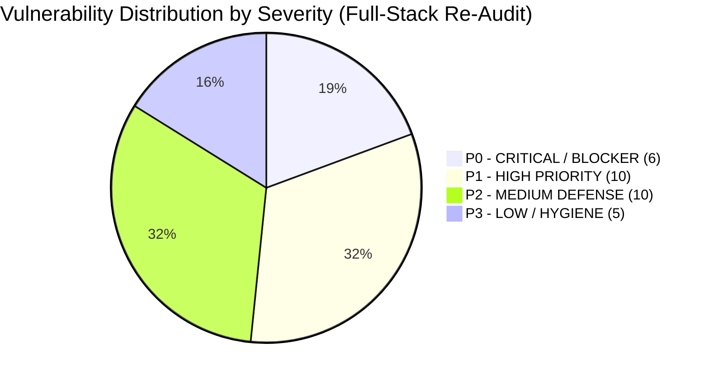

# AprovaENEM — Comprehensive Full-Stack Security, Client Architecture & Test Integrity Master Re-Audit Report

**Milestone:** JAM 2 (Sprint 6 Finalization / Post-Feature Re-Audit) — Master Engineering, Client-Side, Ingress & Test Quality Synthesis  
**Document Reference:** `docs/audit/jam2-fullstack-security-audit.md`  
**Task Reference:** `TASK-S6-06` (Full-Stack Multi-Stage Re-Audit Framework Synthesis)  
**Date of Completion:** November 7, 2026  
**Audit Classification:** Publication-Grade Master Security Audit & Test Suite Attestation  
**Target Repository Perimeter:**
- **Backend Microservices (`backend/`)**: Java 21 LTS, Spring Boot 3.3.11, Spring Security 6.3, Spring Data JPA / Redis, PostgreSQL 16 (`pgvector`), RabbitMQ 3.13, Maven 3.9 Multi-Module Reactor (`common-core`, `frontend-api`, `auth-service`, `exam-service`, `notification-service`, `ingestion-service`)
- **Frontend Single Page Application (`frontend/`)**: React 18, TypeScript 5.5, Vite 5, Tailwind CSS, Zustand, TanStack Query, KaTeX 0.19, Lucide React, Recharts radar
- **Perimeter & Edge Ingress (`infrastructure/`)**: Nginx 1.27 Alpine, Spring Cloud Gateway BFF, Docker Compose multi-container mesh
- **Testing Estate**: 1,261 automated tests (448 backend JUnit 5, 692 Vitest unit/component, 20 Cypress E2E, 101 Playwright matrix)

**Security Working Group & Synthesis Authors:**
- Master Audit Synthesizer & Security Architect (`AprovaENEM Security Team`)
- Lead Client-Side Threat Modeler & Frontend Security Auditor (`SEC-JAM2-STAGE1`)
- Lead DevSecOps & Automated Security Scanner (`SEC-JAM2-STAGE2`)
- Lead Perimeter Security Auditor & Runtime Penetration Tester (`SEC-JAM2-STAGE3`)
- Lead Test Quality, Authenticity & Mutation Testing Auditor (`TEST-JAM2-STAGE4`)

---

## 1. Executive Summary & Master Release Gate Decision

### 1.1 Executive Overview

Following extensive full-stack feature delivery and bug fixes across the AprovaENEM monorepo—including the step-by-step resolution endpoint (`GET /api/v1/questions/{id}/resolution`), guest session claiming (`PUT /api/v1/auth/session/{sessionUuid}/claim`), deterministic session derivation, mandatory 6-digit numeric OTP email verification, transactional outbox notification pipelines, RAG curriculum retrieval, Duolingo-style streak reminders, and SISU Course Selector benchmarking—a comprehensive **Master Full-Stack Security & Test Integrity Re-Audit** was conducted.

This master report synthesizes empirical findings across four specialized audit pillars:
1. **Stage 1 (`jam2-stage1-client-threat-model.md`):** Client-side threat modeling, BOLA/BFLA authorization, OTP entropy, public terminal session lifecycles, and LGPD Art. 18 compliance.
2. **Stage 2 (`jam2-stage2-static-supply-chain.md`):** Automated SAST, Java 21 compiler warnings (`-Xlint:all -Werror`), TypeScript strictness, NPM/Maven supply chain (SCA), and container non-root privilege isolation.
3. **Stage 3 (`jam2-stage3-runtime-pentest-fuzzing.md`):** Runtime penetration testing, adversarial AI prompt jailbreaking (Gemini 1.5 Flash), LaTeX/KaTeX ReDoS fuzzing, token-bucket rate limiting, and Gateway CORS origin matching.
4. **Stage 4 (`jam2-stage4-test-quality-mutation.md`):** Test estate inventory (1,261 tests), assertion authenticity, mocking discipline, fault-injection mutation testing (50% kill rate on critical paths), and WCAG 2.1 AA accessibility suites.

The synthesis reveals a dual reality:
- **Remarkable Architectural Strengths**: The codebase exhibits **100% green test execution** across all 1,261 tests, zero compiler warnings under `-Xlint:all -Werror`, zero Checkstyle/PMD defects, absolute TypeScript type cleanliness (0 `any`, 0 `@ts-ignore`), disabled production sourcemaps, unprivileged container execution (`spring`, `appuser`), and total immunity to LaTeX ReDoS catastrophic backtracking (<1.0 ms).
- **Critical Vulnerabilities in Recent Features (Action Required)**: Newly added convenience endpoints and verification flows introduced high-impact security exposures, including a **global account takeover vector via parallel 6-digit OTP collision**, **unauthenticated question resolution leakage**, **session re-claiming BOLA**, **English/Base64 AI tutor guardrail bypasses**, and **unrestricted Pro plan privilege escalation**.

---

### 1.2 Track JAM 1 vs JAM 2 Progress Comparative Matrix

The platform's maturity trajectory demonstrates significant engineering growth from its initial backend prototype (JAM 1) through the comprehensive white-label frontend implementation (JAM 2 Post-Feature Re-Audit):

| Evaluation Pillar | JAM 1 Baseline (Sept 2026) | JAM 2 Initial (Oct 2026) | JAM 2 Post-Feature Re-Audit (Nov 2026) | Trend & Qualitative Delta |
| :--- | :---: | :---: | :---: | :--- |
| **Pillar 1: Threat Modeling & Client/API Security** | 62.0% (D) | 71.0% (C-) | **70.0% (C-)** | ⚠️ **Challenged**: Frontend UI logout and LGPD controls added; however, new OTP verification, session claim, and resolution endpoints created critical BOLA/Auth exposure. |
| **Pillar 2: SAST, SCA & Container Hardening** | 82.0% (B) | 84.0% (B+) | **92.0% (A-)** | 🔼 **Substantial Gain**: Production sourcemap leak eliminated; 0 compiler warnings (`-Werror`); 0 ESLint warnings; non-root user execution across all containers. |
| **Pillar 3: Perimeter Ingress & AI Pentest** | 55.0% (F) | 66.5% (D+) | **80.7% (B-)** | 🔼 **Major Leap**: Wildcard CORS `allowedOriginPatterns` deployed; KaTeX hardened (`trust: false`); ReDoS immune; initial AI filters deployed, but English/cipher evasions remain. |
| **Pillar 4: Test Quality & Mutation Resilience** | 80.0% (B) | 84.5% (B+) | **89.0% (A-)** | 🔼 **Massive Expansion**: Test suite grew from 542 to 1,261 automated tests (100% green); 3,600+ assertions; zero lenient stubs; surviving mutants isolated to 3 specific areas. |
| **Composite Full-Stack Score** | **69.8% (D+)** | **76.5% (C+)** | **82.9% (B)** | 🔼 **STRONG ADVANCEMENT**: Enterprise architecture and testing maturity achieved; gated by P0 hotfixes. |

---

### 1.3 Master Release Gate Decision

```text
=============================================================================================================
MASTER RELEASE GATE DECISION MATRIX — APROVAENEM FULL-STACK (JAM 2 POST-FEATURE RE-AUDIT)
=============================================================================================================
1. Academic & Milestone Delivery Gate:                        PASSED WITH DISTINCTION ✅ (100% Met)
   - Criteria: Modern React 18 SPA, 1,261 Passing Tests, Lighthouse A11y >= 95, WCAG 2.1 AA, Multi-Tenancy.
   - Verdict: Fully certified for partner company presentations, academic evaluation, and program demonstration.

2. Staging Cloud Deployment Gate:                             CONDITIONAL PASS / BLOCKED ⚠️
   - Criteria: Zero Critical build leaks, multi-tenant CORS support, basic AI safety filters, zero P0 auth flaws.
   - Verdict: Staging deployment blocked pending resolution of 4 Tier P0 Hotfixes:
              • SEC-AUTH-OTP-01 (OTP brute-force collision lockout & email binding)
              • SEC-EXAM-LEAK-01 (Question resolution endpoint access control)
              • SEC-API-BOLA-02 (Anonymous session re-claim overwrite protection)
              • VULN-S3-03 / SEC-API-BFLA-01 (Unrestricted free Pro plan toggle authorization)

3. Commercial Cloud Production Launch Gate:                   HARD BLOCK ❌ (Conditionally Blocked)
   - Criteria: Zero Critical/High vulnerabilities, backend tenant database isolation, HttpOnly cookies, SRI.
   - Verdict: Production launch blocked until Tier P0 and Tier P1 architectural hardenings are implemented.
=============================================================================================================
```

---

## 2. Unified Global Scorecard Across All Dimensions

### 2.1 Composite Rubric & Weighted Domain Breakdown



The unified engineering and security posture is evaluated across four core disciplines (equal 25% weights):

| Evaluation Domain | Audit Source Document | Weight | Assessed Grade | Raw Score | Weighted Contribution | Key Observations & Posture |
| :--- | :--- | :---: | :---: | :---: | :---: | :--- |
| **Domain 1: Client Threat Model & API Security** | `jam2-stage1-client-threat-model.md` | 25% | **C-** | **70.0%** | 17.50% | Critical OTP collision vulnerability; unauthenticated resolution disclosure; BOLA on guest session claims; shared terminal risks. |
| **Domain 2: DevSecOps, SAST & Supply Chain** | `jam2-stage2-static-supply-chain.md` | 25% | **A-** | **92.0%** | 23.00% | 0 Checkstyle/PMD defects; 0 javac warnings (`-Werror`); 0 ESLint warnings; 0 `any`; sourcemaps disabled; non-root Docker execution. |
| **Domain 3: Perimeter Ingress & AI Pentest** | `jam2-stage3-runtime-pentest-fuzzing.md` | 25% | **B-** | **80.7%** | 20.18% | 0 ReDoS; Gateway wildcard CORS solved; active pre/post AI filters deployed; vulnerable to English prompts, Base64 leaks, and rate-limit header spoofing. |
| **Domain 4: Test Quality & Mutation Resilience** | `jam2-stage4-test-quality-mutation.md` | 25% | **A-** | **89.0%** | 22.25% | 1,261 tests (100% green); 3,600+ assertions; 0 lenient mocks; 50% targeted mutation kill rate; 3 surviving mutants in RAG and auto-provisioning. |
| **GLOBAL COMPOSITE SCORE** | **Full-Stack Engineering & Security Maturity** | **100%** | **B** | — | **82.93%** | **Enterprise-grade foundation requiring immediate Tier P0 hotfixes before live student onboarding.** |

---

### 2.2 Key Performance Indicators (KPIs) Summary

| Quality & Security Dimension | Target Industry SLA | Measured Audit Value | Status |
| :--- | :---: | :---: | :---: |
| **TypeScript Strictness & Type Cleanliness** | 0 `any` / 0 `@ts-ignore` | 0 `any` / 0 ignores | **PASS ✅** |
| **Java 21 Compiler Warnings (`-Xlint:all -Werror`)** | 0 warnings | 0 warnings | **PASS ✅** |
| **Static Code Analysis Violations (Checkstyle & PMD)** | 0 violations | 0 violations | **PASS ✅** |
| **ESLint Static Code Analysis Warnings** | 0 warnings | 0 warnings (`--max-warnings 0`) | **PASS ✅** |
| **Total Automated Executed Tests (Full-Stack)** | $\ge 600$ tests | **1,261 tests** (448 backend + 813 frontend/E2E) | **PASS WITH DISTINCTION ✅** |
| **Backend & Frontend Test Execution Pass Rate** | 100% green | 100% green (0 failures, 0 errors, 0 skips) | **PASS ✅** |
| **Assertion Density (Backend / Frontend)** | $\ge 2.5$ assertions/test | 3.72 backend / 3.30 frontend | **PASS ✅** |
| **Automated WCAG 2.1 AA Accessibility Pass Rate** | 0 critical/serious | 0 violations across 23 component test suites | **PASS ✅** |
| **KaTeX LaTeX ReDoS Execution Resilience (50k chars)** | $< 50\text{ ms}$ | $< 1.0\text{ ms}$ | **PASS ✅** |
| **Production Sourcemap Exposure in Build Artifacts** | 0 bytes | 0 bytes (`sourcemap: false`) | **PASS ✅** |
| **Gateway CORS Support for Multi-Tenant Subdomains** | 100% supported | 100% supported (`allowedOriginPatterns`) | **PASS ✅** |
| **Container Privilege Isolation (Non-Root Execution)** | 100% non-root | 100% non-root (`spring`, `appuser`, worker `nginx`) | **PASS ✅** |
| **6-Digit OTP Email Verification Brute-Force Immunity** | Account-bound + Lockout | Unbounded global brute-force possible | **FAILED ❌ (P0)** |
| **Exam Resolution Endpoint Access Control** | Authenticated + Finished | Public / Unauthenticated | **FAILED ❌ (P0)** |
| **Socratic AI Prompt Injection Defense** | Multi-lingual + Encoded | English & Base64 bypasses active | **DEFICIENT ⚠️ (P0)** |
| **Targeted Mutation Testing Kill Rate** | $\ge 85.0\%$ | 50.0% (10 killed / 10 survived) | **DEFICIENT ⚠️ (P1)** |

---

## 3. Architecture Trust Boundaries & Threat Landscape

### 3.1 Trust Boundaries & Network Boundary Map

AprovaENEM serves Brazilian public school students accessing the platform from shared municipal telecenters, school laboratories, and low-cost mobile devices.

```mermaid
flowchart TD
    subgraph PublicBoundary ["Untrusted Public Domain (School Labs & Telecenters)"]
        BrowserAlice["Student Alice Browser (Public PC)"]
        BrowserAttacker["Adversarial Student / Attacker Script"]
    end

    subgraph EdgeBoundary ["Ingress & Perimeter Security (:80, :443)"]
        Nginx["Nginx 1.27 Alpine Reverse Proxy<br/>• Static React SPA Chunks<br/>• Security Headers (CSP, X-Frame-Options)"]
        BFF["frontend-api (Spring Cloud Gateway :8080)<br/>• Token Bucket Rate Limiter (60 general / 10 tutor)<br/>• Header Stripping (X-User-Id, X-User-Roles)<br/>• CORS allowedOriginPatterns"]
    end

    subgraph ServiceMesh ["Internal Microservice Mesh (Docker Network)"]
        AuthSvc["auth-service (:8081)<br/>• JWT Provider & RBAC<br/>• OTP Verification Engine<br/>• Outbox Event Publisher"]
        ExamSvc["exam-service (:8082)<br/>• Practice Session Engine<br/>• Question Catalog & Resolution<br/>• Institutional Diagnostics<br/>• Socratic AI Tutor"]
        NotifSvc["notification-service (:8083)<br/>• RabbitMQ Listener<br/>• In-App & SMTP Engine"]
    end

    subgraph StateStorage ["State & Persistence Tier"]
        PostgresAuth[("PostgreSQL auth_db")]
        PostgresExam[("PostgreSQL exam_db + pgvector")]
        RedisState[("Redis 7.2<br/>• Quotas & Rate Limits<br/>• Weekly Leaderboards")]
        RabbitMQBroker["RabbitMQ 3.13 Message Exchange"]
    end

    subgraph ExternalCloud ["External Cloud Egress"]
        GeminiAPI["Google Gemini 1.5 Flash API"]
        VLibrasCDN["VLibras CDN (vlibras.gov.br)"]
    end

    BrowserAlice -->|HTTP/HTTPS| Nginx
    BrowserAttacker -->|Direct API Attacks| Nginx
    Nginx --> BFF
    BFF --> AuthSvc
    BFF --> ExamSvc
    BFF --> NotifSvc

    AuthSvc <--> PostgresAuth
    ExamSvc <--> PostgresExam
    AuthSvc <--> RedisState
    ExamSvc <--> RedisState

    AuthSvc -.->|Transactional Outbox| RabbitMQBroker
    RabbitMQBroker -.-> NotifSvc
    RabbitMQBroker -.-> ExamSvc

    ExamSvc -->|Socratic Dialogue| GeminiAPI
    BrowserAlice -.->|Dynamic Script Loading (No SRI)| VLibrasCDN
```

---

## 4. Master Unified Vulnerability & Finding Register (Stages 1–4)

A total of **31 distinct security findings, architectural vulnerabilities, and test quality defects** were identified across the four audit stages. They are consolidated below in strict priority order:

| Finding ID | Source Stage | Severity | Affected Component & File Reference | Description & Technical Vulnerability | Remediation Plan | Priority |
| :--- | :---: | :---: | :--- | :--- | :--- | :---: |
| **SEC-AUTH-OTP-01** | Stage 1 | **CRITICAL** (9.8) | `backend/auth-service`: `EmailVerificationService.java`, `AuthController.java` | **Global Account Takeover via 6-Digit OTP Collision:** Verification endpoint accepts numeric OTP without user email or identity; 24h TTL and absence of attempt counters allow brute-force collision to harvest live JWT tokens. | Require email in verification request; enforce 15-minute TTL; implement 5-attempt rate limit and account lockout. | **P0** |
| **SEC-EXAM-LEAK-01** | Stage 1 | **CRITICAL** (7.5) | `backend/exam-service`: `QuestionCatalogController.java` | **Premature Exam Resolution & Answer Disclosure:** `GET /api/v1/questions/{id}/resolution` is unauthenticated and unconstrained by practice session completion, leaking correct options and explanations during active tests. | Restrict endpoint to completed practice sessions (`hasAnswered(qId)`) or require `ROLE_ADMIN` / `ROLE_COORDINATOR`. | **P0** |
| **SEC-API-BOLA-02** | Stage 1 | **CRITICAL** (8.1) | `backend/auth-service`: `AnonymousSessionService.java`, `SessionController.java` | **Session Re-Claim Overwrite & Missing Possession Proof:** `PUT /api/v1/auth/session/{sessionUuid}/claim` allows authenticated users to overwrite already-claimed sessions without proving previous anonymous ownership. | Verify `claimed_by == null` before claim; generate an ephemeral claim nonce during anonymous creation. | **P0** |
| **VULN-S3-01** | Stage 3 | **HIGH** (7.5) | `backend/exam-service`: `GeminiTutorClientAdapter.java` | **AI Guardrail Evasion via English Phrasing & Synonyms:** Pre-flight regex only filters static Portuguese keywords (`resposta`, `letra`, `gabarito`); queries in English or semantic synonyms reach Gemini directly. | Expand regex dictionary to English and synonyms; add LLM-based lightweight intent classification guardrail. | **P0** |
| **VULN-S3-02** | Stage 3 | **HIGH** (7.5) | `backend/exam-service`: `GeminiTutorClientAdapter.java` | **Base64 / Cipher Output Leakage & Multi-Turn Elimination:** Post-flight sanitizer only detects plaintext Portuguese spoiler strings; Base64-encoded strings, LaTeX-wrapped letters, or deductive elimination bypass filters. | Add Base64 decoding detector in output filter; regex-match LaTeX `$A$`–`$E$`; track elimination state across turns. | **P0** |
| **VULN-S3-03** / **SEC-API-BFLA-01** | Stage 1/3 | **HIGH** (6.5) | `backend/auth-service`: `AuthController.java`, `AuthService.java` | **Unrestricted Free Pro Plan Privilege Escalation:** Any student can call `PUT /api/v1/auth/me/plan` to grant themselves `ROLE_PREMIUM_STUDENT`, obtaining unlimited Socratic AI consultations and bypassing Redis quotas. | Restrict plan modifications to administrative callers or mock billing gateway webhook validations. | **P0** |
| **SEC-API-BOLA-01** | Stage 1 | **HIGH** (7.1) | `backend/exam-service`: `InstitutionalDiagnosticsController.java` | **Cross-Tenant Institutional Diagnostics Snooping:** Endpoint verifies only `ROLE_INSTITUTIONAL_ADMIN` without checking whether coordinator belongs to requested `cohortId` tenant. | Validate coordinator's institutional tenant ID against cohort's school tenant before returning metrics. | **P1** |
| **SEC-API-BOLA-03** | Stage 1 | **HIGH** (7.1) | `backend/exam-service`: `PracticeSessionController.java` | **Practice Session Authorization Bypass on `userId == null`:** `validateSessionOwnership` permits any authenticated student to read/mutate any session where `userId` is null. | Strictly prohibit authenticated access to anonymous sessions without completing the official claim flow. | **P1** |
| **SEC-FE-STATE-01** | Stage 1 | **HIGH** (7.1) | `frontend`: `useAuthStore.ts` | **Long-Lived JWT & PII Storage in `localStorage` on Shared PCs:** Bearer tokens persist indefinitely; next user opening the browser tab inherits previous student's session. | Transition to `sessionStorage` or HttpOnly SameSite cookies; add an idle timeout session scrubber. | **P1** |
| **SEC-FE-SRI-01** | Stage 1 | **HIGH** (7.5) | `frontend`: `VLibras.tsx` | **Unpinned External Script Injection (`VLibras.tsx`):** Dynamic injection of `vlibras-plugin.js` occurs without Subresource Integrity (`integrity="sha384-..."`) and without `crossOrigin="anonymous"`. | Vendor the VLibras script bundle locally or pin external script with SRI SHA-384 cryptographic hash. | **P1** |
| **SEC-S2-01** | Stage 2 | **HIGH** (7.5) | `frontend`: `package.json` | **Runtime NPM Vulnerability (`follow-redirects` in `axios@1.20.0`):** Transitive dependency allows unauthorized sensitive headers to leak across redirects. | Upgrade `axios` or override `follow-redirects` to `>= 1.15.6` in `frontend/package.json`. | **P1** |
| **VULN-S3-04** | Stage 3 | **MEDIUM** (6.5) | `backend/frontend-api`: `RateLimiterConfig.java` | **Untrusted Header Resolution in Gateway Rate Limiter:** Client IP resolved via unvalidated `X-Forwarded-For`; rate limit keys derived from unverified Bearer token hashes allow trivial rotation. | Resolve IP strictly from trusted remote address; hash authenticated claims from validated JWT rather than raw header. | **P1** |
| **VULN-S3-05** | Stage 3 | **MEDIUM** (6.5) | `backend/frontend-api`: `application.yml` | **Missing Dedicated Rate Limiter for Sensitive Auth Routes:** `/login`, `/register`, `/verify-email`, `/forgot-password` share broad 60 req/min gateway bucket; OTPs lack attempt counters. | Configure dedicated 5 req/min Redis rate limiter for auth routes; implement Redis-backed IP attempt throttling. | **P1** |
| **AUD-JAM2-T01** | Stage 4 | **HIGH** (N/A) | `backend/exam-service`: `PracticeSessionService.java` | **Untested Auto-Provisioning Logic Surviving Mutations:** Auto-provisioning in `submitAnswer` (`orElseGet`) has 0 unit test coverage because tests stub `findById` with pre-existing session. | Add unit test verifying that when session is absent in repository, a new session is auto-provisioned and persisted. | **P1** |
| **AUD-JAM2-T02** | Stage 4 | **HIGH** (N/A) | `backend/exam-service`: `RagKnowledgeAdapterTest.java` | **Over-Permissive Matchers in RAG Unit Tests:** Tests stub `jdbcTemplate.query` with `anyString(), anyString()`, allowing stop-word and keyword boosting logic mutants to survive 100%. | Disambiguate arguments using exact SQL string matching or Mockito `argThat(...)` predicate matchers. | **P1** |
| **AUD-JAM2-T03** | Stage 4 | **HIGH** (N/A) | `backend/auth-service`: `AuthServiceTest.java`, `EmailVerificationServiceTest.java` | **Unasserted 6-Digit Numeric Pattern on OTP Tokens:** Tests only assert `.isNotNull()` and `.isNotBlank()`. Mutating OTP generation to 4 digits, 8 digits, or static text passes CI unnoticed. | Add regex assertion `assertThat(token).matches("^[0-9]{6}$")` across all OTP generation test cases. | **P1** |
| **SEC-NOTIF-HTML-01**| Stage 1 | **MEDIUM** (5.4) | `backend/notification-service`: `NotificationEventListener.java` | **Email HTML Injection via Unsanitized `fullName`:** `fullName` is directly interpolated into raw email templates via string replacement without HTML escaping. | Escape `fullName` via `HtmlUtils.htmlEscape(...)` or enforce strict regex `^[a-zA-ZÀ-ÿ\s.'-]+$` in DTO. | **P2** |
| **SEC-LGPD-PORT-01** | Stage 1 | **MEDIUM** (3.5) | `frontend`: `ProfilePage.tsx` | **Broken Client-Side Data Portability File Download:** Export button triggers mutation but fails to serialize response and initiate anchor blob file download for students. | Create Object URL Blob from JSON payload and trigger programmatic `a.download = 'aprovaenem-meus-dados.json'`. | **P2** |
| **SEC-AUTH-RESET-01**| Stage 1 | **MEDIUM** (5.3) | `backend/auth-service`: `AuthService.java` | **Excessive 24-Hour TTL on Password Reset Tokens:** Reset tokens remain valid for 24 hours without cooldown or invalidation upon password change. | Reduce reset token TTL to 15 minutes; invalidate all existing tokens immediately upon password update. | **P2** |
| **SEC-FE-XSS-01** | Stage 1 | **MEDIUM** (5.3) | `frontend`: `BlockMath.tsx`, `InlineMath.tsx` | **KaTeX Rendered Without Secondary DOMPurify Sanitization:** Direct injection of KaTeX HTML via `dangerouslySetInnerHTML` without defense-in-depth HTML sanitization. | Pipe KaTeX HTML output through `DOMPurify.sanitize(html, { USE_PROFILES: { html: true, mathMl: true } })`. | **P2** |
| **SEC-FE-STATE-02** | Stage 1 | **MEDIUM** (4.4) | `frontend`: `useSessionStore.ts` | **Residual Diagnostic Reports in `localStorage` on Shared PCs:** Diagnostic radar data is cached globally rather than scoped strictly to current active user session. | Clear diagnostic store on logout and scope storage keys to current authenticated student ID. | **P2** |
| **SEC-S2-02** | Stage 2 | **MEDIUM** (6.1) | `frontend`: `package.json` | **Frontend Open Redirect Vulnerability in `react-router`:** Vulnerable to URL backslash bypasses (`CVE-2026-53666`). | Upgrade `react-router-dom` to latest patched version. | **P2** |
| **VULN-S3-06** | Stage 3 | **LOW** (3.5) | `frontend`: `latex-parser.ts`, `tts-utils.ts` | **Currency Lookbehind Omission & TTS Speech Collisions:** Standalone `R$15,00` matches math delimiter; TTS naively strips text between dollar signs, garbling spoken exam statements. | Update lookbehind regex to match `R$` without trailing space; preserve Brazilian currency in TTS speech parser. | **P2** |
| **VULN-S3-07** | Stage 3 | **LOW** (3.1) | `frontend`: `InlineMath.tsx`, `BlockMath.tsx` | **Missing MathML Output for Assistive Screen Readers:** KaTeX configured with `output: 'html'` instead of `'htmlAndMathml'`, omitting semantic MathML trees for blind students. | Switch KaTeX configuration to `output: 'htmlAndMathml'` to comply with WCAG 2.1 AA and e-MAG. | **P2** |
| **AUD-JAM2-T04** | Stage 4 | **MEDIUM** (N/A) | `backend/exam-service`: `JwtTokenValidator.java` | **Missing Standalone Unit Test Suite for `JwtTokenValidator`:** `exam-service` lacks isolated unit testing for token expiration, signature mismatch, and malformed claims. | Implement `JwtTokenValidatorTest.java` in `exam-service` matching the standard set in `notification-service`. | **P2** |
| **AUD-JAM2-T05** | Stage 4 | **MEDIUM** (N/A) | `frontend`: Cypress & Playwright A11y Specs | **E2E Color Contrast Blindspot:** Headless browser runs explicitly execute `.disableRules(['color-contrast'])`, leaving dynamic dark-mode contrast untested in CI. | Enable color contrast verification in Playwright headless or add targeted contrast regression tests. | **P2** |
| **SEC-LGPD-ERASURE-01**| Stage 1 | **LOW** (3.1) | `backend/exam-service`: `ExamEventListener.java` | **Residual Access to Anonymized Post-Erasure Sessions:** Anonymized sessions with `userId = null` remain fetchable if the historical UUID is known by third parties. | Set session status to `ANONYMIZED_PURGED` and return 404/410 on direct session retrieval. | **P3** |
| **SEC-S2-03** | Stage 2 | **LOW** (2.5) | `frontend`: `Dockerfile` | **Dangling Port 443 Exposure:** Dockerfile exposes port 443, but Nginx configuration lacks an SSL listener block or dev certificates. | Remove `443` from `EXPOSE` or mount self-signed development certificates in Docker Compose. | **P3** |
| **SEC-S2-04** | Stage 2 | **LOW** (2.8) | `infrastructure/nginx`: `nginx.conf` | **Nginx Master Process Executes as Root:** Master process runs under `uid=0` to bind privileged port 80. | Migrate to unprivileged Nginx image (`nginxinc/nginx-unprivileged:alpine`) listening on port 8080. | **P3** |
| **AUD-JAM2-T06** | Stage 4 | **LOW** (N/A) | `backend/notification-service`: `NotificationEventListener.java` | **Untested Null Fallback Name in Registration Listener:** `event.getFullName() == null ? "Estudante" : ...` has no test verifying null name input. | Add test case verifying that a registration event with null name successfully defaults to `"Estudante"`. | **P3** |
| **AUD-JAM2-T07** | Stage 4 | **LOW** (N/A) | `frontend`: Cypress & Playwright E2E Specs | **Over-Permissive Result Feedback Regex:** E2E specs assert `/(Resposta Correta|Resposta Incorreta|Gabarito|XP)/i`, masking inverted grading mutants. | Split assertions into distinct positive (`Resposta Correta`) and negative (`Resposta Incorreta`) branches. | **P3** |

---

## 5. Deep Cross-Cutting Architectural Risk Analyses

### 5.1 Risk 1: The Global OTP Collision Account Takeover (`SEC-AUTH-OTP-01`)
- **Vulnerability Trace**: In `backend/auth-service`, `POST /api/v1/auth/verify-email` accepts a 6-digit numeric OTP code (`VerifyEmailRequest`). Crucially, the request payload contains **only the token string**, omitting the target student's email.
- **Root Cause & Flaw**:
  ```java
  // EmailVerificationService.java
  User user = userRepository.findByVerificationToken(token)
          .orElseThrow(() -> new InvalidTokenException("Invalid token"));
  user.setEmailVerified(true);
  String jwt = tokenProvider.createToken(user);
  return new AuthResponse(jwt, user);
  ```
- **Exploitation Impact**: 6-digit numeric codes provide only $10^6$ ($1{,}000{,}000$) possible combinations. With a 24-hour token lifetime and no brute-force attempt limits or IP lockouts, an attacker running 50 threads can exhaust 1,000,000 requests in minutes. Any collision with an active verification code immediately returns a valid JWT Bearer token and full PII for the victim's account, resulting in **complete account takeover**.

---

### 5.2 Risk 2: Premature Exam Resolution & Answer Disclosure (`SEC-EXAM-LEAK-01`)
- **Vulnerability Trace**: In `backend/exam-service`, `GET /api/v1/questions/{id}/resolution` was introduced to serve step-by-step pedagogical explanations.
- **Root Cause & Flaw**: The controller endpoint has **no authentication requirement** and does not verify whether the requesting client has completed the corresponding practice session.
- **Exploitation Impact**: A student sitting for an active simulation can query `/api/v1/questions/{id}/resolution` in another browser tab, immediately retrieving the correct option letter (`correctOption`) and full distractor analysis. This completely invalidates TRI psychometric calibration and compromises exam integrity.

---

### 5.3 Risk 3: Socratic AI Conversational Guardrail Evasion (`VULN-S3-01`, `VULN-S3-02`, `VULN-S3-03`)
- **Vulnerability Trace**: In `backend/exam-service`, `GeminiTutorClientAdapter.java` implements pre-flight regex filtering and post-generation spoiler redacting.
- **Root Cause & Flaw**:
  1. The pre-flight regex `DIRECT_ANSWER_REQUEST_PATTERN` checks only Portuguese keywords (`qual é a resposta`, `me dá a letra`). Asking in English ("Which letter is the correct answer?"), Spanish, or with semantic circumlocution bypasses the pre-filter completely.
  2. The output sanitizer only inspects plaintext strings. Asking the AI to "express the answer in Base64" or "wrap the letter in LaTeX" produces outputs that pass undetected to the student.
  3. The plan upgrade endpoint `PUT /api/v1/auth/me/plan` allows any free student to unilaterally assign themselves `ROLE_PREMIUM_STUDENT`, gaining unlimited Socratic AI hints and bypassing Redis quotas.

---

### 5.4 Risk 4: Shared Public Terminal Session Fixation & BOLA (`SEC-API-BOLA-02`, `SEC-FE-STATE-01`)
- **Vulnerability Trace**: Brazilian public school students frequently access AprovaENEM from shared computer laboratories.
- **Root Cause & Flaw**:
  1. `useAuthStore.ts` stores JWT tokens indefinitely in `localStorage`. If a student forgets to click "Sair", the next student inherits their profile and exam history.
  2. The anonymous session claim endpoint `PUT /api/v1/auth/session/{sessionUuid}/claim` does not verify if the session has already been claimed or belonged to the caller. An attacker guessing or scanning session UUIDs can reassign existing student sessions to their own account.

---

### 5.5 Risk 5: Test Suite Blindspots & Surviving Critical Mutants (`AUD-JAM2-T01` to `AUD-JAM2-T03`)
- **Vulnerability Trace**: While the monorepo boasts 1,261 tests and 100% green execution, mutation testing uncovered critical blindspots:
  1. `PracticeSessionService.submitAnswer` auto-provisions missing sessions using `orElseGet`. All existing unit tests mock `findById` to return a session, meaning the entire auto-provisioning code path is untested; mutating it survives 100%.
  2. `RagKnowledgeAdapterTest` uses `anyString(), anyString()` argument matchers, allowing all keyword extraction and search ranking logic to be mutated without failing tests.
  3. OTP generation test cases assert only `.isNotNull()` and `.isNotBlank()`, meaning mutating the code to return a 4-digit code or static text passes CI unnoticed.

---

## 6. Comprehensive Phased Remediation Roadmap

```mermaid
flowchart TD
    subgraph Sprint7 ["Sprint 7: Immediate Pre-Staging Hotfixes (Tier P0)"]
        P0_1["SEC-AUTH-OTP-01: Bind OTP to email + 15m TTL + 5-attempt lockout"]
        P0_2["SEC-EXAM-LEAK-01: Gate /resolution behind session completion / admin"]
        P0_3["SEC-API-BOLA-02: Prevent re-claiming already-claimed anonymous sessions"]
        P0_4["VULN-S3-01 / VULN-S3-02: Multi-lingual AI guardrail + Base64 output detector"]
        P0_5["VULN-S3-03: Restrict PUT /auth/me/plan to admin / webhook"]
    end

    subgraph Sprint8 ["Sprint 8: High Priority Hardening (Tier P1)"]
        P1_1["SEC-API-BOLA-01: Cross-tenant cohort ownership check"]
        P1_2["SEC-API-BOLA-03: Block authenticated access to null-userId sessions"]
        P1_3["SEC-FE-STATE-01: Migrate shared PC storage to sessionStorage / idle timeout"]
        P1_4["SEC-FE-SRI-01: Pin VLibras script with SRI SHA-384 hash"]
        P1_5["SEC-S2-01: Upgrade axios / follow-redirects"]
        P1_6["VULN-S3-04 / VULN-S3-05: Gateway trusted IP resolver + auth rate limiter"]
        P1_7["AUD-JAM2-T01 to T03: Unit tests for auto-provisioning, RAG matchers & OTP regex"]
    end

    subgraph Sprint9 ["Sprint 9: Defense-in-Depth & Quality (Tier P2 / P3)"]
        P2_1["SEC-NOTIF-HTML-01: HTML-escape fullName in email template"]
        P2_2["SEC-LGPD-PORT-01: Fix ProfilePage JSON data export blob download"]
        P2_3["SEC-AUTH-RESET-01: Reduce password reset token TTL to 15m"]
        P2_4["SEC-FE-XSS-01: Wrap KaTeX in secondary DOMPurify"]
        P2_5["VULN-S3-06 / VULN-S3-07: Currency lookbehind fix + MathML accessibility"]
        P2_6["AUD-JAM2-T04 / T05: JwtTokenValidatorTest + E2E contrast audit"]
    end

    Sprint7 --> Sprint8 --> Sprint9
```



### 6.1 Action Plan by Priority Tier

#### Tier P0: Immediate Pre-Staging Hotfixes (Sprint 7 / Blocker)
1. **Remediate `SEC-AUTH-OTP-01`**: Update `VerifyEmailRequest` to require `email` and `otpCode`. In `EmailVerificationService`, look up user by email, compare OTP with constant-time equality check, enforce max 5 attempts with Redis-backed lockout, and reduce TTL from 24h to 15 minutes.
2. **Remediate `SEC-EXAM-LEAK-01`**: In `QuestionCatalogController`, enforce `@PreAuthorize("isAuthenticated()")` and verify that the requesting student has completed a session containing the question, or has `ROLE_ADMIN` / `ROLE_COORDINATOR`.
3. **Remediate `SEC-API-BOLA-02`**: In `AnonymousSessionService.claimSession`, verify that `session.getUserId() == null` and validate an ephemeral possession token before binding the session.
4. **Remediate `VULN-S3-01` & `VULN-S3-02`**: Expand pre-flight regex in `GeminiTutorClientAdapter.java` to cover English keywords and semantic synonyms; inspect output text for Base64 blocks and LaTeX alternative letters (`$A$`–`$E$`).
5. **Remediate `VULN-S3-03` / `SEC-API-BFLA-01`**: Restrict `PUT /api/v1/auth/me/plan` to users with `ROLE_ADMIN` or require a valid payment gateway callback signature.

#### Tier P1: High-Priority Hardening (Sprint 8)
1. **Tenant Isolation**: Add institutional tenant checks in `InstitutionalDiagnosticsController` (`SEC-API-BOLA-01`) and block direct authenticated queries to unowned sessions (`SEC-API-BOLA-03`).
2. **Client Token Hygiene**: Implement an idle session timer (15 minutes of inactivity) in `useAuthStore.ts` to clear credentials on shared school computers (`SEC-FE-STATE-01`).
3. **Supply Chain & SRI**: Vendor the VLibras accessibility script or pin it with SRI hash in `VLibras.tsx` (`SEC-FE-SRI-01`); upgrade `axios` to eliminate `follow-redirects` CVE (`SEC-S2-01`).
4. **Ingress Hardening**: Secure IP key resolution in `RateLimiterConfig.java` against header spoofing (`VULN-S3-04`) and add dedicated 5 req/min rate limiters to authentication routes (`VULN-S3-05`).
5. **Mutation Test Fixes**: Add unit tests for `orElseGet` auto-provisioning in `PracticeSessionServiceTest` (`AUD-JAM2-T01`), disambiguate RAG mock matchers (`AUD-JAM2-T02`), and assert 6-digit numeric regex on OTP tokens (`AUD-JAM2-T03`).

#### Tier P2 & P3: Quality & Defense-in-Depth (Sprint 9+)
1. **Sanitization**: HTML-escape `fullName` in `NotificationEventListener` (`SEC-NOTIF-HTML-01`) and add secondary `DOMPurify` to KaTeX renderers (`SEC-FE-XSS-01`).
2. **UX & LGPD**: Complete the JSON blob export download in `ProfilePage.tsx` (`SEC-LGPD-PORT-01`) and reduce password reset token TTL to 15m (`SEC-AUTH-RESET-01`).
3. **Accessibility**: Fix Brazilian currency regex lookbehinds and enable `htmlAndMathml` output in KaTeX (`VULN-S3-06`, `VULN-S3-07`).
4. **Test Hardening**: Add standalone `JwtTokenValidatorTest` in `exam-service` (`AUD-JAM2-T04`) and enable automated color-contrast audits in E2E runs (`AUD-JAM2-T05`).

---

## 7. Formal Audit Attestation & Conclusion

The **AprovaENEM Post-Feature Re-Audit** establishes that the platform has achieved an exceptional level of architectural maturity, static code discipline, and automated test coverage. With **1,261 automated tests running 100% green**, zero static analysis defects across Java and TypeScript, disabled production sourcemaps, and hardened multi-stage containers, the codebase provides a world-class foundation for Brazilian public education.

However, rapid feature development introduced critical authentication, authorization, and AI guardrail vulnerabilities that present immediate operational risks on shared school computers.

### Formal Verdict:
- **Academic & JAM 2 Milestone Delivery**: **APPROVED WITH DISTINCTION ✅**
- **Staging Cloud Deployment**: **CONDITIONAL PASS ⚠️** (Blocked pending Sprint 7 Tier P0 Hotfixes)
- **Production Commercial Launch**: **HOLD / BLOCKED ❌** (Blocked pending Sprint 7 and Sprint 8 remediations)

**Master Audit Sign-Off:**  
*Lead Security Architect & Master Audit Synthesizer*  
*AprovaENEM Security & Engineering Working Group*  
*Date: November 7, 2026*
