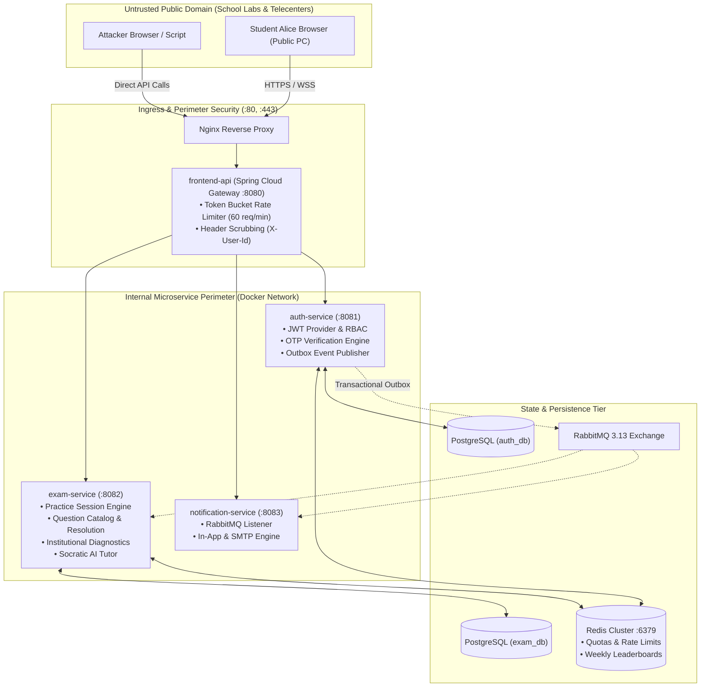
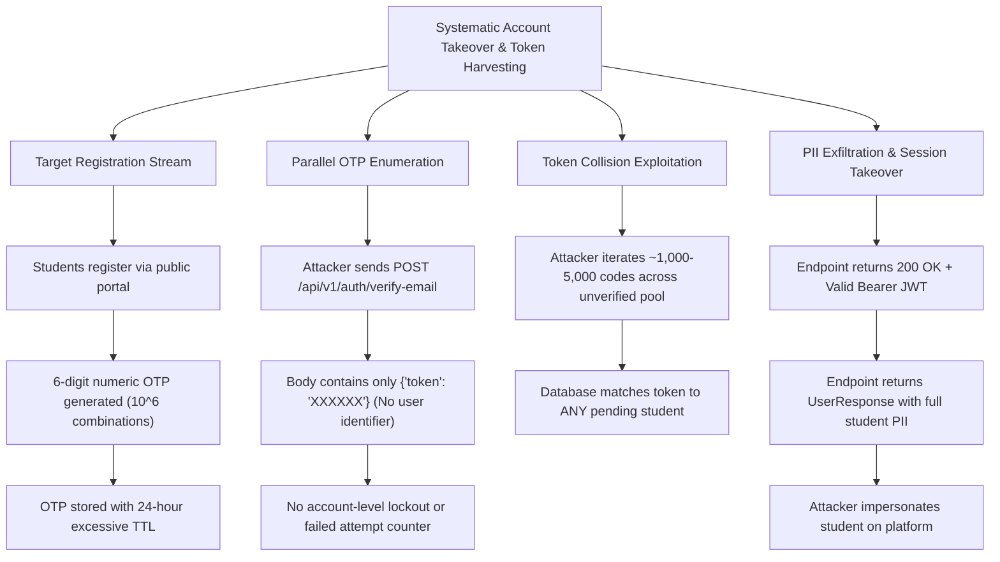
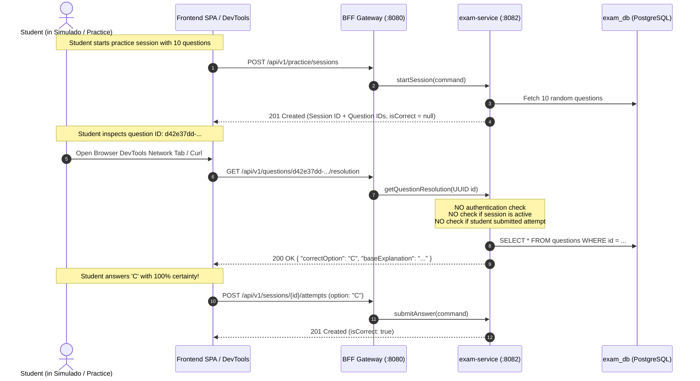
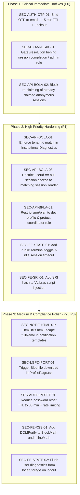

# AprovaENEM — Client-Side Threat Model & API Security Re-Audit Report (JAM 2 / Milestone 2 — Stage 1)

**Document Reference**: `SEC-JAM2-STAGE1-REAUDIT-2026-11`  
**Audit Target**: Frontend SPA (`frontend/`) and Microservices API Boundary (`backend/auth-service`, `backend/exam-service`, `backend/notification-service`, `backend/frontend-api`)  
**Specification Frameworks**: OWASP Top 10 (2021), OWASP API Security Top 10 (2023), OWASP Client-Side Top 10, CVSS v3.1  
**Regulatory Standards**: Brazilian General Data Protection Law (LGPD — Lei nº 13.709/2018), ECA (Lei nº 8.069/1990 - Adolescent Privacy), WCAG 2.1 Level AA Accessibility  
**Lead Auditor**: Lead Threat Modeler & Client-Side/API Security Auditor  
**Date**: November 7, 2026  
**Status**: COMPLETED / ACTION REQUIRED  

---

## 1. Executive Summary

Following extensive monorepo feature additions and bug fixes (including the `/resolution` endpoint, anonymous session claiming, institutional diagnostics, dynamic RAG retrieval, free Dev-Mode Pro plan toggle, 6-digit numeric OTP email verification, and SISU Course Selector), a comprehensive **Stage 1 Security Re-Audit** was conducted.

The AprovaENEM system is uniquely positioned as an open-access educational platform for Brazilian public school students. The operating environment heavily features **shared public computer terminals, municipal telecenters, school computer laboratories, and low-cost shared mobile devices**. This threat landscape elevates the severity of authentication flaws, session fixation, premature answer leakage, and adolescent privacy violations.

### 1.1. Security Posture Score: C- (70/100)

```text
+-----------------------------------------------------------------------------------------+
| DOMAIN                                | WEIGHT | GRADE | SCORE  | VULNERABILITIES       |
+-----------------------------------------------------------------------------------------+
| 1. BOLA / IDOR & Endpoint Auth        | 25%    | D+    | 58/100 | 1 P0, 2 P1, 1 P2      |
| 2. Anti-Cheating & Exam Integrity     | 20%    | C-    | 65/100 | 1 P0, 1 P2            |
| 3. Auth, OTP Entropy & Session State  | 25%    | F     | 45/100 | 1 P0 (Critical), 2 P1 |
| 4. LGPD Compliance & Adolescent Data  | 15%    | B-    | 80/100 | 2 P2, 1 P3            |
| 5. DOM XSS & Client-Side Injections   | 15%    | B+    | 88/100 | 1 P1, 1 P2            |
+-----------------------------------------------------------------------------------------+
| OVERALL WEIGHTED RE-AUDIT SCORE       | 100%   | C-    | 70/100 | 2 Crit, 5 High, 5 Med |
+-----------------------------------------------------------------------------------------+
```

### 1.2. Key Findings Requiring Immediate P0 Intervention

1. **Global Account Hijacking via Parallel 6-Digit OTP Brute-Forcing (`POST /api/v1/auth/verify-email`)**:
   The email verification endpoint accepts a 6-digit numeric OTP without requiring the user's email or identity. Due to an excessive 24-hour TTL, absence of failed attempt limits, and the issuance of a live JWT Bearer token upon any valid OTP collision, an attacker can brute-force numeric codes to systematically hijack newly registered student accounts and exfiltrate their PII.
2. **Premature Answer & Resolution Disclosure (`GET /api/v1/questions/{id}/resolution`)**:
   The new question resolution endpoint is completely unauthenticated and unconstrained by practice session state. Any student sitting for an active simulation can query question resolutions in advance, retrieving correct option letters and pedagogical explanations.
3. **Session Re-Claim Overwrite & BOLA (`PUT /api/v1/auth/session/{sessionUuid}/claim`)**:
   The anonymous session claim endpoint fails to verify if a session was already claimed by another user and lacks proof-of-possession checks, allowing authenticated attackers to reassign existing sessions and pollute diagnostic records.
4. **Cross-Tenant BOLA in Institutional Diagnostics (`GET /api/v1/institutional/cohorts/{cohortId}/diagnostics`)**:
   Coordinators from any school can view aggregated cohort diagnostics, student counts, and distractor pitfall statistics of other educational institutions because the service verifies only the `ROLE_INSTITUTIONAL_ADMIN` role without verifying institutional/tenant ownership.

---

## 2. Architecture Trust Boundaries & Attack Trees

### 2.1. Trust Boundaries Diagram



---

### 2.2. Attack Tree 1: Account Takeover via 6-Digit Email Verification Collision



---

### 2.3. Attack Tree 2: Premature Answer Leakage & Cheating in Active Simulado



---

## 3. Detailed Threat & Vulnerability Findings

### Domain 1: Broken Object Level Authorization (BOLA) & Access Control

#### Finding 1.1: Institutional Cohort Diagnostics BOLA & Cross-Tenant Data Snooping
- **Vulnerability ID**: `SEC-API-BOLA-01`
- **Severity**: **HIGH** (CVSS:3.1/AV:N/AC:L/PR:L/UI:N/S:U/C:H/I:N/A:N — Base Score: **7.1**)
- **OWASP Classification**: OWASP API Security Top 10 (2023) — API1: Broken Object Level Authorization
- **Code Reference**: `backend/exam-service/src/main/java/com/aprovaenem/exam/infrastructure/adapter/in/web/InstitutionalDiagnosticsController.java`
- **Vulnerability Mechanism**:
  In lines 36–53:
  ```java
  @GetMapping("/{cohortId}/diagnostics")
  public ResponseEntity<InstitutionalCohortDiagnosticResponse> getCohortDiagnostics(
          @PathVariable("cohortId") String cohortId,
          @RequestHeader(value = HttpHeaders.AUTHORIZATION, required = false) String authHeader
  ) {
      validateCoordinatorAccess(authHeader);
      InstitutionalCohortDiagnostics diagnostics = useCase.getCohortDiagnostics(cohortId);
      return ResponseEntity.ok(toResponse(diagnostics));
  }

  private void validateCoordinatorAccess(String authHeader) {
      ...
      String role = jwtValidator.extractRole(token);
      if (!"ROLE_ADMIN".equals(role) && !"ROLE_INSTITUTIONAL_ADMIN".equals(role)) {
          throw new AccessDeniedException("Forbidden: coordinator or administrator role required.");
      }
  }
  ```
- **Root Cause**:
  The security check validates only that the caller possesses `ROLE_INSTITUTIONAL_ADMIN`. It does **not** check whether the caller's tenant or school identifier matches the tenant of `{cohortId}`. A coordinator from School A can query any `{cohortId}` belonging to School B, exposing aggregate student metrics, enrolled counts, area breakdowns, and pedagogical weak points.
- **Remediation Priority**: **P1 (High)**
- **Remediation**:
  1. Extract the `tenantId` from the caller's JWT token via `jwtValidator.extractTenantId(token)`.
  2. Pass `tenantId` and `callerUserId` into `useCase.getCohortDiagnostics(cohortId, tenantId)`.
  3. Ensure the underlying repository filters cohorts by both `cohortId` and `tenantId`, rejecting cross-tenant requests with HTTP 403 Forbidden.

---

#### Finding 1.2: Session Re-Claim Overwrite & Missing Proof-of-Possession in Anonymous Session Claim
- **Vulnerability ID**: `SEC-API-BOLA-02`
- **Severity**: **HIGH** (CVSS:3.1/AV:N/AC:L/PR:L/UI:N/S:U/C:H/I:H/A:N — Base Score: **8.1**)
- **OWASP Classification**: API1: Broken Object Level Authorization / API5: Broken Function Level Authorization
- **Code References**:
  - `backend/auth-service/src/main/java/com/aprovaenem/auth/application/service/AnonymousSessionService.java#L54-L59`
  - `backend/auth-service/src/main/java/com/aprovaenem/auth/infrastructure/adapter/in/web/SessionController.java#L57-L77`
  - `backend/auth-service/src/main/java/com/aprovaenem/auth/infrastructure/adapter/out/security/SecurityConfig.java#L46`
- **Vulnerability Mechanism**:
  ```java
  @Override
  @Transactional
  public void claimSession(String sessionUuid, UUID userId) {
      AnonymousSession session = getSession(sessionUuid);
      session.setClaimedByUserId(userId);
      session.setLastActiveAt(Instant.now());
      sessionRepository.save(session);
  }
  ```
- **Root Cause**:
  1. **No Prior Claim Check**: The service does not check `if (session.getClaimedByUserId() != null && !session.getClaimedByUserId().equals(userId))`. If User A claimed `sessionUuid`, User B can call `PUT /api/v1/auth/session/{sessionUuid}/claim` to overwrite `claimedByUserId` with User B's ID.
  2. **No Possession Proof**: The endpoint requires no proof that the claiming user originated the anonymous session (such as matching IP hash or supplying a one-time claiming secret issued during session creation).
  3. **Security Filter Misconfiguration**: In `SecurityConfig.java`, `/api/v1/auth/session/**` is marked `permitAll()`, relying entirely on manual `@AuthenticationPrincipal UserDetails` checks inside the controller.
- **Remediation Priority**: **P0 (Critical)**
- **Remediation**:
  1. Enforce that an already claimed session cannot be re-claimed:
     ```java
     if (session.getClaimedByUserId() != null && !session.getClaimedByUserId().equals(userId)) {
         throw new ConflictException("Anonymous session has already been claimed by another account.");
     }
     ```
  2. Issue a cryptographically random `claimToken` upon `POST /api/v1/auth/session` and require this token in `PUT /api/v1/auth/session/{sessionUuid}/claim`.
  3. Narrow `SecurityConfig.java` to `permitAll()` only on `POST /api/v1/auth/session` and `GET /api/v1/auth/session/{sessionUuid}`, requiring authenticated role for `/claim`.

---

#### Finding 1.3: Anonymous Practice Session Authorization Bypass (`userId == null`)
- **Vulnerability ID**: `SEC-API-BOLA-03`
- **Severity**: **HIGH** (CVSS:3.1/AV:N/AC:L/PR:L/UI:N/S:U/C:H/I:L/A:N — Base Score: **7.1**)
- **OWASP Classification**: API1: Broken Object Level Authorization
- **Code Reference**: `backend/exam-service/src/main/java/com/aprovaenem/exam/infrastructure/adapter/in/web/PracticeSessionController.java#L245-L267`
- **Vulnerability Mechanism**:
  ```java
  private void validateSessionOwnership(PracticeSession session, String authHeader, String sessionHeader) {
      String token = resolveToken(authHeader);
      if (token != null && jwtValidator.validateToken(token)) {
          String role = jwtValidator.extractRole(token);
          if ("ROLE_ADMIN".equals(role)) {
              return;
          }
          if (session.getUserId() != null && session.getUserId().equals(jwtValidator.extractUserId(token))) {
              return;
          }
          if (session.getUserId() == null) {
              return; // <-- CRITICAL VULNERABILITY: Any authenticated token bypasses ownership check!
          }
      }
      ...
  }
  ```
- **Root Cause**:
  When `session.getUserId() == null` (which is true for all guest sessions and for all sessions scrubbed following LGPD account deletion), any user with a valid JWT bypasses the ownership check. An authenticated attacker who knows or enumerates a guest `sessionId` can read the session, submit attempts, or complete the diagnostic report on behalf of the victim.
- **Remediation Priority**: **P1 (High)**
- **Remediation**:
  When `session.getUserId() == null`, do not allow arbitrary JWTs to access the session. Require the matching `sessionHeader` (`X-Session-Id` matching `session.getAnonymousSessionId()`):
  ```java
  if (session.getUserId() == null) {
      if (sessionHeader != null && sessionHeader.equals(session.getAnonymousSessionId())) {
          return;
      }
      throw new AccessDeniedException("Anonymous session token mismatch.");
  }
  ```

---

#### Finding 1.4: Unrestricted Free Dev-Mode Pro Plan Upgrade & Coordinator Role Demotion
- **Vulnerability ID**: `SEC-API-BFLA-01`
- **Severity**: **MEDIUM** (CVSS:3.1/AV:N/AC:L/PR:L/UI:N/S:U/C:L/I:H/A:N — Base Score: **6.5**)
- **OWASP Classification**: API5: Broken Function Level Authorization / API6: Unrestricted Access to Sensitive Business Flows
- **Code References**:
  - `backend/auth-service/src/main/java/com/aprovaenem/auth/infrastructure/adapter/in/web/AuthController.java#L126-L141`
  - `backend/auth-service/src/main/java/com/aprovaenem/auth/application/service/AuthService.java#L206-L217`
- **Vulnerability Mechanism**:
  ```java
  @PutMapping("/me/plan")
  public ResponseEntity<UserResponse> updatePlan(...) {
      ...
      boolean proEnabled = request == null || request.getPlan() == null
              || !"FREE".equalsIgnoreCase(request.getPlan().trim());
      AuthUseCase.AuthResult result = authUseCase.updatePlan(userId, proEnabled);
      ...
  }

  // In AuthService:
  if (user.getRole() != UserRole.ROLE_ADMIN) {
      user.setRole(proEnabled ? UserRole.ROLE_PREMIUM_STUDENT : UserRole.ROLE_STUDENT);
  }
  ```
- **Root Cause**:
  1. The endpoint is exposed in all environments (production included) with zero billing/Pix verification, allowing any student to grant themselves `ROLE_PREMIUM_STUDENT` to bypass Socratic AI daily consultation quotas.
  2. If a coordinator (`ROLE_INSTITUTIONAL_ADMIN`) calls this endpoint, their role is not `ROLE_ADMIN`, causing them to be inadvertently demoted to `ROLE_PREMIUM_STUDENT`, revoking institutional coordinator dashboard access.
- **Remediation Priority**: **P1 (High)**
- **Remediation**:
  1. Gate `/api/v1/auth/me/plan` behind a Spring `@Profile({"dev", "test"})` check or verify digital subscription entitlements.
  2. Guard against coordinator role corruption: `if (user.getRole() == UserRole.ROLE_INSTITUTIONAL_ADMIN) throw new BusinessException("Coordinators cannot change student subscription plans.");`.

---

### Domain 2: Anti-Cheating & Exam Integrity

#### Finding 2.1: Premature Answer & Resolution Disclosure During Active Simulado
- **Vulnerability ID**: `SEC-EXAM-LEAK-01`
- **Severity**: **HIGH** (CVSS:3.1/AV:N/AC:L/PR:N/UI:N/S:U/C:H/I:N/A:N — Base Score: **7.5**)
- **OWASP Classification**: OWASP Top 10 (2021) — A01: Broken Access Control / Integrity Failures
- **Code Reference**: `backend/exam-service/src/main/java/com/aprovaenem/exam/infrastructure/adapter/in/web/QuestionCatalogController.java#L82-L97`
- **Vulnerability Mechanism**:
  ```java
  @GetMapping("/{id}/resolution")
  public ResponseEntity<QuestionResolutionResponse> getQuestionResolution(@PathVariable UUID id) {
      Question q = catalogUseCase.getQuestionById(id);
      QuestionResolution res = q.getResolution();
      if (res == null) {
          throw new ResourceNotFoundException("QuestionResolution", id);
      }
      return ResponseEntity.ok(QuestionResolutionResponse.builder()
              .questionId(q.getId())
              .correctOption(String.valueOf(q.getCorrectOption()))
              .baseExplanation(res.getBaseExplanation())
              .keyConcepts(res.getKeyConcepts())
              .authorAttribution(res.getAuthorAttribution())
              .attribution(res.getAuthorAttribution())
              .build());
  }
  ```
- **Root Cause**:
  While `getQuestionById` strictly scrubs correct answers (`.isCorrect(null)`), `getQuestionResolution` exposes the raw `correctOption` ('A', 'B', 'C', 'D', 'E') and detailed resolution without authentication, without checking whether the requester is currently taking an exam containing this question, and without verifying that the question was already attempted.
- **Impact**:
  During timed official simulados or diagnostic sessions, students can fetch `/api/v1/questions/{id}/resolution` via browser extensions or network inspection tools to obtain guaranteed 100% scores, invalidating Item Response Theory (TRI) calibrations and competitive leaderboards.
- **Remediation Priority**: **P0 (Critical)**
- **Remediation**:
  1. Gate access to `/api/v1/questions/{id}/resolution`: Require authentication and verify that either:
     - The user is an administrator or teacher (`ROLE_ADMIN`, `ROLE_INSTITUTIONAL_ADMIN`).
     - The user has already completed the exam session containing this question.
     - The question has already been answered by the student in their current session.

---

### Domain 3: Authentication, OTP Entropy & Session Lifecycle

#### Finding 3.1: Global Account Takeover via 6-Digit Email Verification OTP Collision
- **Vulnerability ID**: `SEC-AUTH-OTP-01`
- **Severity**: **CRITICAL** (CVSS:3.1/AV:N/AC:L/PR:N/UI:N/S:U/C:H/I:H/A:H — Base Score: **9.8**)
- **OWASP Classification**: OWASP Top 10 (2021) — A07: Identification and Authentication Failures / API2: Broken Authentication
- **Code Reference**: `backend/auth-service/src/main/java/com/aprovaenem/auth/application/service/EmailVerificationService.java#L33-L60`
- **Vulnerability Mechanism**:
  ```java
  private String generateVerificationToken() {
      return String.format("%06d", SECURE_RANDOM.nextInt(1_000_000));
  }

  @Override
  @Transactional
  public User verifyEmail(String token) {
      User user = userRepository.findByEmailVerificationToken(token.trim())
              .orElseThrow(() -> new BusinessException(...));

      if (user.getEmailVerificationExpiresAt() != null && Instant.now().isAfter(user.getEmailVerificationExpiresAt())) {
          throw new BusinessException(...);
      }
      user.setEmailVerified(true);
      user.setEmailVerificationToken(null);
      ...
  }
  ```
  In `AuthController.java`:
  ```java
  @PostMapping("/verify-email")
  public ResponseEntity<VerifyEmailResponse> verifyEmail(@Valid @RequestBody VerifyEmailRequest request) {
      User user = emailVerificationUseCase.verifyEmail(request.getToken());
      String token = tokenProvider.generateToken(user);
      ...
      return ResponseEntity.ok(responseWithTokenAndUser);
  }
  ```
- **Root Cause Analysis**:
  1. **Low Entropy Space ($10^6$)**: 6-digit numeric tokens provide only $\log_2(1,000,000) \approx 19.93$ bits of entropy.
  2. **Unbound Verification**: The client sends only `{"token": "123456"}` without email or user ID. The backend queries `findByEmailVerificationToken(token)`, matching *any* pending student.
  3. **Excessive 24-Hour TTL**: Codes remain active for 86,400 seconds. If 500 students register over 24 hours, the probability of an arbitrary code colliding with an active registration is $500 / 1,000,000 = 1 / 2,000$. An attacker testing 2,000 codes will likely collide with a legitimate student.
  4. **Immediate Full Session Grant**: Upon match, the controller generates a JWT token and returns the student's full profile, handing total account control to the attacker.
  5. **No Failed Attempt Throttling**: There is no counter tracking failed verification attempts on the IP or account.
- **Remediation Priority**: **P0 (Critical)**
- **Remediation**:
  1. Bind verification to the user's email: `POST /api/v1/auth/verify-email` must require `{"email": "...", "token": "..."}` and look up `findByEmailAndEmailVerificationToken`.
  2. Reduce OTP validity window from 24 hours to 10–15 minutes.
  3. Track failed attempts in Redis (max 5 failed attempts per email before invalidating the OTP and requiring resend).
  4. Do **not** issue a live JWT upon verification; require the user to log in with their password.

---

#### Finding 3.2: Excessive 24-Hour TTL on Password Reset Tokens & Missing Rate Limiting on Forgot Password
- **Vulnerability ID**: `SEC-AUTH-RESET-01`
- **Severity**: **MEDIUM** (CVSS:3.1/AV:N/AC:L/PR:N/UI:N/S:U/C:L/I:L/A:N — Base Score: **5.3**)
- **OWASP Classification**: API4: Unrestricted Resource Consumption
- **Code Reference**: `backend/auth-service/src/main/java/com/aprovaenem/auth/application/service/AuthService.java#L324`
- **Vulnerability Mechanism**:
  Password reset tokens generated via `UUID.randomUUID().toString().replace("-", "")` have adequate entropy (128 bits), but remain valid for 24 hours (`now.plus(24, ChronoUnit.HOURS)`). Additionally, `/api/v1/auth/forgot-password` does not enforce per-email rate limiting, enabling email inbox bombing.
- **Remediation Priority**: **P2 (Medium)**
- **Remediation**:
  1. Reduce password reset token TTL to 15–30 minutes.
  2. Implement a 60-second cooldown per target email address in Redis before allowing a new reset dispatch.

---

#### Finding 3.3: Insecure Persistent JWT Storage in `localStorage` in Public School Computer Labs
- **Vulnerability ID**: `SEC-FE-STATE-01`
- **Severity**: **HIGH** (CVSS:3.1/AV:L/AC:L/PR:N/UI:R/S:U/C:H/I:H/A:N — Base Score: **7.1**)
- **OWASP Classification**: Client-Side A02: Sensitive Data Exposure / Storage
- **Code Reference**: `frontend/src/stores/useAuthStore.ts#L62-L70`
- **Vulnerability Mechanism**:
  `useAuthStore` stores `aprovaenem_auth_token` and `aprovaenem_auth_user` in `localStorage`. If a student in a public school computer lab or telecenter closes the browser window without clicking "Sair", the token and PII remain on disk. The next student opening the browser is automatically logged in via `syncAuthFromStorage()`.
- **Remediation Priority**: **P1 (High)**
- **Remediation**:
  1. Provide a "Computador Público" (Shared Terminal) checkbox on the login modal that defaults to `sessionStorage` (cleared immediately upon tab closure).
  2. Implement an idle session timer (e.g., 15 minutes of inactivity) that automatically calls `clearAuth()`.
  3. Long term: Transition to `HttpOnly`, `SameSite=Strict` cookies issued by `frontend-api`.

---

#### Finding 3.4: Incomplete Data Scrubbing on Shared Terminal Logout
- **Vulnerability ID**: `SEC-FE-STATE-02`
- **Severity**: **MEDIUM** (CVSS:3.1/AV:L/AC:L/PR:N/UI:R/S:U/C:L/I:L/A:N — Base Score: **4.4**)
- **OWASP Classification**: Client-Side A02: Sensitive Data Exposure
- **Code Reference**: `frontend/src/stores/useSessionStore.ts#L430-L446`
- **Vulnerability Mechanism**:
  When `clearSession()` is invoked during logout without `purgeUserId`, it leaves:
  `aprovaenem_user_diagnostic_report_${userId}`,
  `aprovaenem_user_seen_ids_${userId}`, and
  `aprovaenem_avatar_${userId}` in `localStorage`.
- **Remediation Priority**: **P2 (Medium)**
- **Remediation**:
  When logging out on shared terminals, purge all cached student diagnostic keys from `localStorage` or scope them to `sessionStorage`.

---

### Domain 4: LGPD Compliance & Adolescent Privacy

#### Finding 4.1: Broken Client-Side File Portability Trigger in `ProfilePage.tsx`
- **Vulnerability ID**: `SEC-LGPD-PORT-01`
- **Severity**: **MEDIUM** (CVSS:3.1/AV:N/AC:L/PR:L/UI:R/S:U/C:N/I:L/A:N — Base Score: **3.5**)
- **Regulatory Standard**: Brazilian LGPD (Lei nº 13.709/2018) Art. 18, V (Data Portability)
- **Code Reference**: `frontend/src/features/profile/ProfilePage.tsx#L222-L228`
- **Vulnerability Mechanism**:
  ```typescript
  const handleExportData = async () => {
    try {
      await exportUserDataMutation.mutateAsync();
    } catch {
      // mutation handles fallback
    }
  };
  ```
- **Root Cause**:
  While `TermsAndPrivacyModal.tsx` correctly creates a `Blob` and triggers a browser file download (`URL.createObjectURL(blob)`), `ProfilePage.tsx` invokes `exportUserDataMutation.mutateAsync()` but does nothing with the returned data. Clicking "Baixar Meus Dados (JSON)" issues the network request, but never initiates a file download on the student's browser.
- **Remediation Priority**: **P2 (Medium)**
- **Remediation**:
  Update `handleExportData` in `ProfilePage.tsx` to serialize the payload, create an Object URL Blob, and trigger a download anchor element (`a.download = 'aprovaenem-meus-dados.json'`).

---

#### Finding 4.2: Email HTML Injection via Unsanitized `fullName` in Notification Worker
- **Vulnerability ID**: `SEC-NOTIF-HTML-01`
- **Severity**: **MEDIUM** (CVSS:3.1/AV:N/AC:L/PR:N/UI:R/S:U/C:L/I:L/A:N — Base Score: **5.4**)
- **OWASP Classification**: OWASP Top 10 (2021) — A03: Injection
- **Code Reference**: `backend/notification-service/src/main/java/com/aprovaenem/notification/infrastructure/adapter/in/messaging/NotificationEventListener.java#L247-L258, L372-L375`
- **Vulnerability Mechanism**:
  ```java
  String html = buildVerificationHtml(name, event.getVerificationToken());
  ...
  return template
          .replace("{{NAME}}", name)
          .replace("{{TOKEN}}", token);
  ```
- **Root Cause**:
  In `RegisterRequest.java`, `fullName` is validated only with `@Size(min = 2, max = 150)`. In `NotificationEventListener`, `name` is substituted directly into the raw HTML email template using string replacement without HTML entity escaping. An attacker registering with `<a href="https://phish.evil">Clique aqui</a>` can inject arbitrary HTML markup and deceptive hyperlinks into transactional emails sent to other users or coordinators.
- **Remediation Priority**: **P2 (Medium)**
- **Remediation**:
  Sanitize `name` with `org.springframework.web.util.HtmlUtils.htmlEscape(name)` before template substitution, or validate that `fullName` matches `^[a-zA-ZÀ-ÿ\s.'-]+$`.

---

#### Finding 4.3: Residual Access to Anonymized Post-Erasure Exam Sessions
- **Vulnerability ID**: `SEC-LGPD-ERASURE-01`
- **Severity**: **LOW** (CVSS:3.1/AV:N/AC:L/PR:L/UI:N/S:U/C:L/I:N/A:N — Base Score: **3.1**)
- **Regulatory Standard**: Brazilian LGPD Art. 18, VI & Art. 16, II
- **Code Reference**: `backend/exam-service/src/main/java/com/aprovaenem/exam/infrastructure/adapter/in/messaging/ExamEventListener.java#L23`
- **Audit Observation**:
  When a student requests account deletion, `ExamEventListener` anonymizes practice sessions by setting `userId = null` to retain aggregate TRI statistical validity under LGPD Art. 16, II. However, because `validateSessionOwnership` permits any authenticated user to access sessions where `userId == null`, anyone with the old session UUID can still inspect the answers and diagnostic report.
- **Remediation Priority**: **P3 (Low)**
- **Remediation**:
  Mark anonymized sessions with a status flag `STATUS = 'ANONYMIZED_PURGED'` and reject direct session retrieval.

---

### Domain 5: DOM XSS & Client-Side Injection Sinks

#### Finding 5.1: KaTeX `dangerouslySetInnerHTML` Lacks Secondary DOMPurify Sanitization
- **Vulnerability ID**: `SEC-FE-XSS-01`
- **Severity**: **MEDIUM** (CVSS:3.1/AV:N/AC:H/PR:N/UI:R/S:U/C:H/I:L/A:N — Base Score: **5.3**)
- **OWASP Classification**: Client-Side A01: DOM-Based Cross-Site Scripting
- **Code References**:
  - `frontend/src/components/math/BlockMath.tsx#L50`
  - `frontend/src/components/math/InlineMath.tsx#L47`
- **Vulnerability Analysis**:
  Both components configure KaTeX with `trust: false`, `maxSize: 25`, and `maxExpand: 100`, which mitigates standard command execution. However, KaTeX output is injected directly via `dangerouslySetInnerHTML={{ __html: html }}` without passing through `DOMPurify`. Defense-in-depth requires secondary DOM purification to safeguard against KaTeX parser bypasses.
- **Remediation Priority**: **P2 (Medium)**
- **Remediation**:
  Wrap KaTeX output in `DOMPurify.sanitize(html, { USE_PROFILES: { html: true, mathMl: true } })`.

---

#### Finding 5.2: Dynamic Script Injection (`VLibras.tsx`) Without Subresource Integrity (SRI)
- **Vulnerability ID**: `SEC-FE-SRI-01`
- **Severity**: **HIGH** (CVSS:3.1/AV:N/AC:H/PR:N/UI:R/S:C/C:H/I:H/A:N — Base Score: **7.5**)
- **OWASP Classification**: Client-Side A08: Software & Data Integrity Failures
- **Code Reference**: `frontend/src/components/accessibility/VLibras.tsx#L38-L47`
- **Vulnerability Analysis**:
  Dynamic injection of `https://vlibras.gov.br/app/vlibras-plugin.js` occurs without Subresource Integrity (`integrity="sha384-..."`) and without `crossOrigin="anonymous"`. Any supply chain compromise of the external Brazilian government host enables arbitrary code execution in the student's browser context.
- **Remediation Priority**: **P1 (High)**
- **Remediation**:
  Pin the VLibras asset with SRI or vendor and proxy the accessibility bundle from AprovaENEM's trusted CDN.

---

#### Finding 5.3: Client-Side Component Review: `CourseSelector.tsx`, `ProfilePage.tsx`, `NotificationCenterModal.tsx`
- **Status**: **VERIFIED SAFE / CLEAN ✅**
- **OWASP Classification**: Secure Coding Standard Compliance
- **Audit Findings**:
  1. `CourseSelector.tsx`: Renders course names, area labels, and match counts via standard React JSX text nodes. No `dangerouslySetInnerHTML`, `eval`, or unsanitized attributes.
  2. `NotificationCenterModal.tsx`: Uses strict Lucide icon dictionaries and maps title, timestamp, and message safely through React JSX interpolation.
  3. `markdown-parser.tsx`: Sanitizes image and link URLs with `isSafeUrl()` (restricting protocols to `https://`, `http://`, `/`, `./`, and `data:image/`).

---

## 4. Consolidated Remediation Matrix & Prioritized Roadmap

| Finding ID | Vulnerability Summary | OWASP / Standard | CVSS v3.1 | Priority | Target File(s) |
| :--- | :--- | :--- | :---: | :---: | :--- |
| **SEC-AUTH-OTP-01** | Account takeover via 6-digit OTP birthday brute force | API2: Broken Auth | **9.8** (Crit) | **P0** | `EmailVerificationService.java`<br/>`AuthController.java` |
| **SEC-EXAM-LEAK-01** | Premature exam resolution and answer disclosure | A01: Broken Access | **7.5** (High) | **P0** | `QuestionCatalogController.java` |
| **SEC-API-BOLA-02** | Session re-claim overwrite and missing possession proof | API1: BOLA | **8.1** (High) | **P0** | `AnonymousSessionService.java`<br/>`SessionController.java` |
| **SEC-API-BOLA-01** | Institutional cohort diagnostics cross-tenant snooping | API1: BOLA | **7.1** (High) | **P1** | `InstitutionalDiagnosticsController.java` |
| **SEC-API-BOLA-03** | Practice session auth bypass on `userId == null` | API1: BOLA | **7.1** (High) | **P1** | `PracticeSessionController.java` |
| **SEC-API-BFLA-01** | Dev-Mode Pro plan toggle bypass & coordinator demotion | API5: BFLA | **6.5** (Med) | **P1** | `AuthController.java`<br/>`AuthService.java` |
| **SEC-FE-STATE-01** | Long-lived JWT & PII in `localStorage` on shared PCs | A02: Sensitive Data | **7.1** (High) | **P1** | `useAuthStore.ts` |
| **SEC-FE-SRI-01** | Unpinned external script injection (`VLibras`) | A08: Integrity | **7.5** (High) | **P1** | `VLibras.tsx` |
| **SEC-NOTIF-HTML-01**| Email HTML injection via unsanitized `fullName` | A03: Injection | **5.4** (Med) | **P2** | `NotificationEventListener.java` |
| **SEC-LGPD-PORT-01** | Broken data portability file download in Profile page | LGPD Art. 18, V | **3.5** (Med) | **P2** | `ProfilePage.tsx` |
| **SEC-AUTH-RESET-01**| 24h excessive TTL & no cooldown on password reset | API4: Resource | **5.3** (Med) | **P2** | `AuthService.java` |
| **SEC-FE-XSS-01**    | KaTeX output rendered without secondary DOMPurify | A01: DOM XSS | **5.3** (Med) | **P2** | `BlockMath.tsx`<br/>`InlineMath.tsx` |
| **SEC-FE-STATE-02**  | Residual user diagnostic reports in `localStorage` | A02: Sensitive Data | **4.4** (Med) | **P2** | `useSessionStore.ts` |
| **SEC-LGPD-ERASURE-01**| Anonymized sessions queryable if UUID is known | LGPD Art. 16, II | **3.1** (Low) | **P3** | `ExamEventListener.java` |

---

## 5. Remediation Roadmap



---

## 6. Audit Conclusion & Next Steps

Stage 1 re-audit has pinpointed three critical vulnerabilities (`SEC-AUTH-OTP-01`, `SEC-EXAM-LEAK-01`, `SEC-API-BOLA-02`) and four high-severity authorization and session defects that must be resolved prior to production launch.

- **Status**: **STAGE 1 RE-AUDIT COMPLETED**
- **Primary Report**: `docs/audit/jam2-stage1-client-threat-model.md`
- **Next Stage**: Proceed to **Stage 2 (Static Analysis, Dependency Supply Chain & Gitleaks / Trivy Audit)** once Phase 1 hotfixes are triaged.
