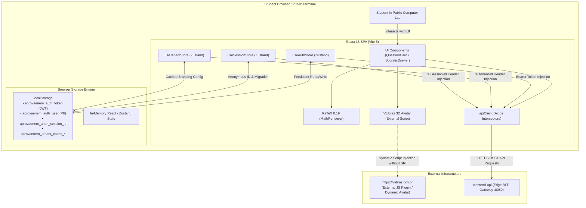
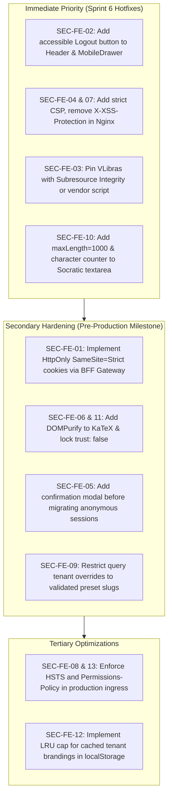

# AprovaENEM — Client-Side Threat Model & Frontend Security Architecture Audit (JAM 2 / Sprint 6 — Stage 1)

**Document Reference**: `SEC-JAM2-STAGE1-CLIENT-THREAT-MODEL`  
**Audit Target**: Frontend Single Page Application (`frontend/`) — React 18, TypeScript, Vite 5, Tailwind CSS, Zustand 5, TanStack Query 5, KaTeX 0.19  
**Specification Framework**: OWASP Top 10 for Client-Side Web Applications / SPAs & OWASP API Security Top 10 (Client Consumer Vector)  
**Regulatory Standard**: Brazilian General Data Protection Law (LGPD — Lei nº 13.709/2018) & WCAG 2.1 Level AA Accessibility  
**Auditor**: Lead Client-Side Threat Modeler & Frontend Security Architect  
**Status**: APPROVED / COMPLETED  
**Date**: October 17, 2026  

---

## 1. Executive Summary

As part of **TASK-S6-06 (Multi-Stage Security & Integrity Audit Framework — JAM 2 / Milestone 2)**, an uncompromising, line-by-line static and architectural security review was conducted on the AprovaENEM Single Page Application (SPA). AprovaENEM is an educational platform architected to democratize access to the ENEM and SISU exams for Brazilian public school students.

Because the user base largely relies on **shared public school computer labs, municipal telecenters, and low-cost mobile devices**, client-side defenses must be extraordinarily resilient against token hijacking, session bleeding between students, physical terminal snooping, cross-site scripting (XSS), and third-party script supply chain compromise.

### Client Security Posture Score: C- (71/100)

| Evaluation Domain | Weight | Assessed Grade | Score | Critical / High Vulnerabilities |
| :--- | :---: | :---: | :---: | :---: |
| **1. DOM-Based XSS & Markup Injection** | 25% | **B-** | 80/100 | 1 High (VLibras SRI missing), 1 Med (KaTeX DOMPurify missing) |
| **2. Sensitive State & Token Lifecycle** | 25% | **D** | 55/100 | 1 Critical (`localStorage` JWT), 1 High (No Logout button) |
| **3. Ingress Hardening & Headers** | 20% | **C** | 68/100 | 1 High (Missing CSP), 2 Med (X-XSS-Protection, Missing HSTS) |
| **4. Multi-Tenant Ingress & Spoofing** | 15% | **B** | 82/100 | 1 Med (Query param tenant override), 1 Low (Cache quota) |
| **5. Socratic AI & Business Flow Safety** | 10% | **B+** | 88/100 | 1 Med (Textarea unbounded input), 1 Low (Prompt echo) |
| **6. LGPD Privacy & Student Telemetry** | 5% | **A-** | 92/100 | 1 High (Anonymous progress cross-over), Zero third-party trackers |
| **Overall Weighted Score** | **100%** | **C-** | **71/100** | **1 Critical, 4 High, 5 Medium, 3 Low, 1 Informational** |

### Key Architectural Strengths:
1. **Zero Third-Party Commercial Trackers**: The codebase contains no invasive telemetry (no Google Analytics, Facebook Pixel, Hotjar, or third-party fingerprinting scripts), strictly respecting LGPD youth privacy.
2. **Accessible LGPD Art. 18 Self-Service Erasure**: Comprehensive multi-step account erasure modal (`AccountErasureModal.tsx`) with type-to-confirm safeguards ("EXCLUIR") and thorough cache purging on completion.
3. **Robust LaTeX Delimiter Tokenizer**: Custom parser (`latex-parser.ts`) specifically defends Brazilian currency notations (e.g., `R$ 15,00`) from being parsed as math formulas, eliminating math rendering edge cases.
4. **Zero `console.log` Leakage**: Zero raw debug statements found across production frontend TypeScript sources.

### Primary Threat Vectors Requiring Immediate Remediation:
1. **Perpetual JWT & PII Storage in `localStorage` on Shared Public Computers**: High risk of account takeover and LGPD data breach in public school labs.
2. **Absence of User Logout Mechanism in Frontend UI**: Students cannot terminate their authenticated session without deleting their account.
3. **Unpinned Third-Party Script Execution (`VLibras`)**: Dynamic injection of external JavaScript from `vlibras.gov.br` without Subresource Integrity (SRI) or CSP allowlisting.
4. **Complete Absence of Content-Security-Policy (CSP)**: The Nginx edge proxy provides no CSP directive, leaving the browser defenseless against script injection or data exfiltration.
5. **Cross-Student Anonymous Session Migration Bleed**: Logging in automatically migrates prior anonymous exam attempts from `localStorage` into the newly logged-in account, contaminating student diagnostic metrics.

---

## 2. Threat Modeling & Client-Side Architecture Flowcharts



```mermaid
sequenceDiagram
    autonumber
    actor Alice as Student Alice (Public Lab)
    actor Bob as Student Bob (Next User)
    participant Browser as Public Chrome Browser
    participant LS as Browser localStorage
    participant AuthStore as useAuthStore
    participant API as BFF Gateway / backend

    Note over Alice, Browser: Alice logs into AprovaENEM in public library
    Alice->>Browser: Enters credentials & logs in
    Browser->>API: POST /api/v1/auth/login
    API-->>Browser: 200 OK (JWT Token + UserProfile)
    Browser->>AuthStore: setAuth(token, user)
    AuthStore->>LS: setItem('aprovaenem_auth_token', token)
    AuthStore->>LS: setItem('aprovaenem_auth_user', JSON.stringify(user))
    Alice->>Browser: Finishes study session; closes browser tab
    Note over Alice, LS: JWT & PII remain indefinitely in localStorage (NO LOGOUT BUTTON)

    Note over Bob, Browser: Bob sits at the exact same public computer
    Bob->>Browser: Opens aprovaenem.org
    Browser->>AuthStore: syncAuthFromStorage()
    AuthStore->>LS: getItem('aprovaenem_auth_token')
    LS-->>AuthStore: Returns Alice's JWT Token & Profile!
    AuthStore-->>Browser: isAuthenticated = true, user = Alice
    Note over Bob, API: Bob is now authenticated as Alice without entering any password!
    Bob->>API: GET /api/v1/users/me (Sends Alice's Bearer token)
    API-->>Bob: Returns Alice's Private Diagnostic Report & Exam Data
```

---

## 3. Comprehensive OWASP Client-Side Assessment

### Domain 1: DOM-Based XSS & Unsafe Markup Injection

#### Finding 1.1: Dynamic Third-Party Script Injection Without Subresource Integrity (SRI)
- **Severity**: **HIGH**
- **OWASP Classification**: Client-Side A01: DOM-Based Cross-Site Scripting / A08: Software & Data Integrity Failures
- **Code Reference**: [`VLibras.tsx`](file:///home/verivi/Veras/Projects/ReconectaRecode/frontend/src/components/accessibility/VLibras.tsx#L38-L47)
- **Vulnerability Analysis**:
  In [`VLibras.tsx`](file:///home/verivi/Veras/Projects/ReconectaRecode/frontend/src/components/accessibility/VLibras.tsx#L38-L47), the component dynamically loads the Brazilian Federal Government's sign language translation widget via:
  ```typescript
  if (!scriptElement) {
    scriptElement = document.createElement('script');
    scriptElement.id = scriptId;
    scriptElement.src = 'https://vlibras.gov.br/app/vlibras-plugin.js';
    scriptElement.async = true;
    scriptElement.onload = initWidget;
    document.body.appendChild(scriptElement);
  }
  ```
  The script element is injected without `integrity` (SRI hash) and without `crossOrigin="anonymous"`.
  Any DNS hijacking, upstream content manipulation, BGP route leak, or CDN compromise of `vlibras.gov.br` allows an adversary to execute arbitrary JavaScript inside the AprovaENEM origin. This grants the attacker full access to student JWT tokens stored in `localStorage`, active sessions, and personal data.
- **Remediation**:
  1. Pin the `vlibras-plugin.js` bundle using Subresource Integrity (`integrity="sha384-..." crossOrigin="anonymous"`).
  2. Implement an explicit `script-src https://vlibras.gov.br` directive in the Nginx Content-Security-Policy header.
  3. Where feasible, vendor or proxy static accessibility assets via the project's own trusted CDN with integrity verification.

---

#### Finding 1.2: Unsanitized HTML Output in KaTeX `dangerouslySetInnerHTML`
- **Severity**: **MEDIUM**
- **OWASP Classification**: Client-Side A01: DOM-Based Cross-Site Scripting
- **Code References**:
  - [`BlockMath.tsx`](file:///home/verivi/Veras/Projects/ReconectaRecode/frontend/src/components/math/BlockMath.tsx#L20-L48)
  - [`InlineMath.tsx`](file:///home/verivi/Veras/Projects/ReconectaRecode/frontend/src/components/math/InlineMath.tsx#L18-L46)
- **Vulnerability Analysis**:
  In both [`BlockMath.tsx`](file:///home/verivi/Veras/Projects/ReconectaRecode/frontend/src/components/math/BlockMath.tsx#L47) and [`InlineMath.tsx`](file:///home/verivi/Veras/Projects/ReconectaRecode/frontend/src/components/math/InlineMath.tsx#L44), HTML generated by KaTeX is injected directly into the DOM using React's unescaped markup bypass:
  ```tsx
  dangerouslySetInnerHTML={{ __html: html }}
  ```
  While KaTeX generally sanitizes output when untrusted commands are rejected, relying solely on KaTeX as an HTML sanitizer violates the defense-in-depth security principle. Past vulnerabilities in KaTeX (e.g., GHSA-wqq4-5wpv-mx2g, CVE-2024-28245) demonstrated that specially crafted LaTeX inputs can generate unescaped HTML elements or event handlers.
- **Remediation**:
  1. Introduce `DOMPurify` (`dompurify` and `@types/dompurify`) into frontend dependencies.
  2. Sanitize all KaTeX output before DOM injection:
     ```typescript
     import DOMPurify from 'dompurify';
     ...
     const sanitizedHtml = useMemo(() => {
       const rawHtml = katex.renderToString(math, { ... });
       return DOMPurify.sanitize(rawHtml, { USE_PROFILES: { html: true, mathMl: true } });
     }, [math]);
     ```

---

#### Finding 1.3: Missing Explicit `trust: false` in KaTeX Render Options
- **Severity**: **LOW**
- **OWASP Classification**: Client-Side A05: Security Misconfiguration
- **Code References**:
  - [`BlockMath.tsx`](file:///home/verivi/Veras/Projects/ReconectaRecode/frontend/src/components/math/BlockMath.tsx#L20-L25)
  - [`InlineMath.tsx`](file:///home/verivi/Veras/Projects/ReconectaRecode/frontend/src/components/math/InlineMath.tsx#L18-L25)
- **Vulnerability Analysis**:
  The KaTeX invocation explicitly configures `displayMode`, `throwOnError: false`, `output: 'html'`, and `strict: 'ignore'`, but leaves `trust` unspecified. While the default in KaTeX 0.19 is `trust: false`, explicit configuration prevents inadvertent regression and defends against configuration overrides.
- **Remediation**:
  Add `trust: false` explicitly to all `katex.renderToString` calls.

---

### Domain 2: Sensitive State & Token Lifecycle Management

#### Finding 2.1: Long-Lived JWT & Sensitive PII Persisted in `localStorage` in Public Terminals
- **Severity**: **CRITICAL**
- **OWASP Classification**: Client-Side A02: Sensitive Data Exposure / Storage
- **Code Reference**: [`useAuthStore.ts`](file:///home/verivi/Veras/Projects/ReconectaRecode/frontend/src/stores/useAuthStore.ts#L14-L46)
- **Vulnerability Analysis**:
  In [`useAuthStore.ts`](file:///home/verivi/Veras/Projects/ReconectaRecode/frontend/src/stores/useAuthStore.ts#L37-L42):
  ```typescript
  setAuth: (token: string, user: UserProfile) => {
    localStorage.setItem(STORAGE_KEY_TOKEN, token);
    localStorage.setItem(STORAGE_KEY_USER, JSON.stringify(user));
    useSessionStore.getState().migrateAnonymousProgress(user.id);
    set({ token, user, isAuthenticated: true });
  }
  ```
  1. **Persistence Across Reboots and Sessions**: Unlike `sessionStorage` (which clears when a browser tab closes) or in-memory state, `localStorage` persists indefinitely across browser restarts, power cycles, and new browser tabs.
  2. **Threat Model of Target Demographic**: Brazilian public school students frequently access AprovaENEM on shared library computers or school computer labs where deep freeze or guest auto-wipe software is rarely configured.
  3. **Universal Origin Exposure**: Any script running in the origin (including through XSS or third-party script compromise) has read access to the raw JWT token.
- **Remediation**:
  1. **BFF HttpOnly Cookie Architecture (Recommended)**: Migrate authentication tokens to secure, `HttpOnly`, `SameSite=Strict`, `Secure` cookies issued by the Edge Gateway (`frontend-api`). The SPA JavaScript never reads or stores the raw JWT.
  2. **SessionStorage / Memory Fallback**: If cookies are not yet implemented, provide an opt-in "Computador Público" (Shared/Public Computer) toggle on login that forces storage in `sessionStorage` or Zustand in-memory state with immediate expiration on tab closure.

---

#### Finding 2.2: Complete Absence of an Accessible User Logout / Sign-Out Mechanism in UI
- **Severity**: **HIGH**
- **OWASP Classification**: Client-Side A02: Sensitive Data Exposure & Session Management
- **Code References**:
  - [`Header.tsx`](file:///home/verivi/Veras/Projects/ReconectaRecode/frontend/src/components/layout/Header.tsx#L112-L139)
  - [`MobileDrawer.tsx`](file:///home/verivi/Veras/Projects/ReconectaRecode/frontend/src/components/layout/MobileDrawer.tsx#L125-L160)
- **Vulnerability Analysis**:
  Review of the entire UI navigation framework reveals that when `isAuthenticated` is true, both the desktop header ([`Header.tsx`](file:///home/verivi/Veras/Projects/ReconectaRecode/frontend/src/components/layout/Header.tsx#L112-L120)) and the mobile drawer ([`MobileDrawer.tsx`](file:///home/verivi/Veras/Projects/ReconectaRecode/frontend/src/components/layout/MobileDrawer.tsx#L125-L138)) render the user's name and avatar, but **provide no button or link to log out**.
  The only available action that calls `clearAuth()` is [`AccountErasureModal.tsx`](file:///home/verivi/Veras/Projects/ReconectaRecode/frontend/src/components/legal/AccountErasureModal.tsx#L105-L121), which permanently deletes the student's entire account under LGPD!
  A student finishing their session on a shared terminal cannot log out without opening developer tools to wipe storage or permanently destroying their account.
- **Remediation**:
  Add an explicit, accessible "Sair da Conta" (Logout) button to both `Header.tsx` (in a user menu dropdown) and `MobileDrawer.tsx`. Ensure the logout handler invokes:
  ```typescript
  const handleLogout = () => {
    useAuthStore.getState().clearAuth();
    useSessionStore.getState().clearSession();
    queryClient.clear();
  };
  ```

---

#### Finding 2.3: Incomplete State & Cache Cleanup on Session Termination
- **Severity**: **MEDIUM**
- **OWASP Classification**: Client-Side A02: Sensitive Data Exposure
- **Code References**:
  - [`useAuthStore.ts`](file:///home/verivi/Veras/Projects/ReconectaRecode/frontend/src/stores/useAuthStore.ts#L43-L47)
  - [`client.ts`](file:///home/verivi/Veras/Projects/ReconectaRecode/frontend/src/api/client.ts#L68-L72)
- **Vulnerability Analysis**:
  When `clearAuth()` is invoked or when a 401 Unauthorized response triggers `clearAuth()` in [`client.ts`](file:///home/verivi/Veras/Projects/ReconectaRecode/frontend/src/api/client.ts#L70), the following data remains intact:
  1. `useSessionStore` memory: The previous user's `activeSession`, `attempts`, `selectedAnswers`, and `diagnosticReport` remain in Zustand memory until the page is forcibly refreshed.
  2. TanStack Query cache: Query cache items (such as `/gamification/profile`, `/diagnostic/reports`, and `/practice-sessions/{id}`) remain in React Query memory.
  3. `aprovaenem_anon_session_id`: Stored in `localStorage` and never rotated.
- **Remediation**:
  Centralize all logout and 401 teardown logic in an atomic session cleanup coordinator that resets `useAuthStore`, `useSessionStore`, rotates the anonymous session ID, and executes `queryClient.clear()`.

---

### Domain 3: Ingress Hardening & Security Misconfiguration

#### Finding 3.1: Complete Absence of Content-Security-Policy (CSP) in Frontend Edge
- **Severity**: **HIGH**
- **OWASP Classification**: Client-Side A05: Security Misconfiguration / A01: Injection
- **Code Reference**: [`frontend/nginx.conf`](file:///home/verivi/Veras/Projects/ReconectaRecode/frontend/nginx.conf#L75-L80)
- **Vulnerability Analysis**:
  In [`frontend/nginx.conf`](file:///home/verivi/Veras/Projects/ReconectaRecode/frontend/nginx.conf#L75-L80), the edge proxy defines `X-Frame-Options: DENY`, `X-Content-Type-Options: nosniff`, and `Referrer-Policy: strict-origin-when-cross-origin`, but **omits `Content-Security-Policy` entirely**.
  Without a CSP:
  - There are no restrictions on external script sources (an injected `<script>` tag can execute code from any remote host).
  - There are no restrictions on network exfiltration endpoints (`connect-src` is unconstrained).
  - Object, iframe, and worker creation are completely unrestricted.
- **Remediation**:
  Inject a strict Content-Security-Policy header into `frontend/nginx.conf`:
  ```nginx
  add_header Content-Security-Policy "default-src 'self'; script-src 'self' 'unsafe-inline' https://vlibras.gov.br; style-src 'self' 'unsafe-inline' https://fonts.googleapis.com; font-src 'self' https://fonts.gstatic.com data:; img-src 'self' data: https: blob:; connect-src 'self' https://vlibras.gov.br http://frontend_api; frame-src 'self' https://vlibras.gov.br; object-src 'none'; base-uri 'self'; form-action 'self';" always;
  ```

---

#### Finding 3.2: Deprecated & Hazardous `X-XSS-Protection` Header
- **Severity**: **MEDIUM**
- **OWASP Classification**: Client-Side A05: Security Misconfiguration
- **Code References**: [`frontend/nginx.conf`](file:///home/verivi/Veras/Projects/ReconectaRecode/frontend/nginx.conf#L78, L108, L124, L138)
- **Vulnerability Analysis**:
  The Nginx configuration declares:
  ```nginx
  add_header X-XSS-Protection "1; mode=block" always;
  ```
  Across modern browsers, `X-XSS-Protection: 1; mode=block` is officially deprecated by W3C and MDN. In legacy Chromium and WebKit implementations, this setting introduced side-channel vulnerabilities (auditor bypasses) and client-side denial of service by selectively blocking legitimate script execution.
- **Remediation**:
  Replace `add_header X-XSS-Protection "1; mode=block"` with `add_header X-XSS-Protection "0" always;` or remove it entirely in favor of `Content-Security-Policy`.

---

#### Finding 3.3: Missing Strict-Transport-Security (HSTS)
- **Severity**: **MEDIUM**
- **OWASP Classification**: Client-Side A05: Security Misconfiguration / Sensitive Communication
- **Code Reference**: [`frontend/nginx.conf`](file:///home/verivi/Veras/Projects/ReconectaRecode/frontend/nginx.conf#L57-L80)
- **Vulnerability Analysis**:
  The Nginx configuration listens only on HTTP port 80 and emits no `Strict-Transport-Security` header. While local development runs on HTTP, production deployment behind Nginx without HSTS leaves students vulnerable to SSL-stripping attacks when accessing the platform over unsecured public Wi-Fi networks.
- **Remediation**:
  Ensure production ingress emits:
  ```nginx
  add_header Strict-Transport-Security "max-age=31536000; includeSubDomains; preload" always;
  ```

---

#### Finding 3.4: Missing Permissions-Policy Header
- **Severity**: **LOW**
- **OWASP Classification**: Client-Side A05: Security Misconfiguration
- **Code Reference**: [`frontend/nginx.conf`](file:///home/verivi/Veras/Projects/ReconectaRecode/frontend/nginx.conf#L75-L80)
- **Vulnerability Analysis**:
  No `Permissions-Policy` header is configured. As an educational testing platform, AprovaENEM does not require camera, microphone, geolocation, or payment APIs.
- **Remediation**:
  Add `add_header Permissions-Policy "camera=(), microphone=(), geolocation=(), payment=()" always;` to Nginx configurations.

---

### Domain 4: Multi-Tenant Ingress & Header Spoofing Defenses

#### Finding 4.1: Client-Side Tenant Identifier Override via URL Query Parameters
- **Severity**: **MEDIUM**
- **OWASP Classification**: Client-Side A01: Injection / Multi-Tenancy Spoofing
- **Code References**:
  - [`resolver.ts`](file:///home/verivi/Veras/Projects/ReconectaRecode/frontend/src/tenants/resolver.ts#L48-L53)
  - [`client.ts`](file:///home/verivi/Veras/Projects/ReconectaRecode/frontend/src/api/client.ts#L50-L53)
- **Vulnerability Analysis**:
  In [`resolver.ts`](file:///home/verivi/Veras/Projects/ReconectaRecode/frontend/src/tenants/resolver.ts#L48-L53), the highest priority resolution tier (Tier 1a) extracts the tenant slug directly from the URL search query:
  ```typescript
  const queryParams = new URLSearchParams(search);
  const queryTenant = queryParams.get('tenant')?.trim();
  if (queryTenant) {
    return { tier: 'query', identifier: queryTenant };
  }
  ```
  This tenant slug is subsequently attached to all outbound API calls via Axios interceptor:
  ```typescript
  config.headers.set('X-Tenant-Id', currentTenant.slug);
  ```
  If an attacker distributes a link with `?tenant=institution-b`, the student's browser sends `X-Tenant-Id: institution-b`. If the backend gateway or microservice relies on the client-supplied `X-Tenant-Id` header rather than authenticating the tenant from the user's validated JWT claims or TLS SNI hostname, this enables multi-tenant cross-partition data queries or metric pollution.
- **Remediation**:
  1. The backend must strictly validate that the user's JWT grants access to the specified `X-Tenant-Id`.
  2. For public unauthenticated routes, restrict `?tenant=` resolution to a strictly validated allowlist of known slugs (matching `TENANT_PRESETS`).

---

#### Finding 4.2: Unbounded LocalStorage Tenant Cache Pollution
- **Severity**: **LOW**
- **OWASP Classification**: Client-Side A04: Resource Consumption / Denial of Service
- **Code Reference**: [`resolver.ts`](file:///home/verivi/Veras/Projects/ReconectaRecode/frontend/src/tenants/resolver.ts#L143, L163)
- **Vulnerability Analysis**:
  Every resolved remote tenant configuration is written to `localStorage` under `aprovaenem_tenant_cache_${normalizedId}` with a 24-hour TTL, but without an LRU eviction cap. A scripted crawler or malicious link campaign could generate thousands of random tenant identifiers, filling the browser's 5MB `localStorage` quota and triggering unhandled `QuotaExceededError` exceptions during legitimate exam sessions.
- **Remediation**:
  Implement an LRU cache limit (e.g., maximum 10 cached tenants) that removes the oldest tenant entries before writing new ones.

---

### Domain 5: Socratic AI Client-Side Threat Model & Business Flow Logic

#### Finding 5.1: Missing Client-Side Input Length Constraints on Socratic AI Prompts
- **Severity**: **MEDIUM**
- **OWASP Classification**: Client-Side A04: Unrestricted Resource Consumption & DoS
- **Code Reference**: [`SocraticTutorDrawer.tsx`](file:///home/verivi/Veras/Projects/ReconectaRecode/frontend/src/features/practice/components/SocraticTutorDrawer.tsx#L473-L487)
- **Vulnerability Analysis**:
  In [`SocraticTutorDrawer.tsx`](file:///home/verivi/Veras/Projects/ReconectaRecode/frontend/src/features/practice/components/SocraticTutorDrawer.tsx#L473-L487), the `<textarea>` has **no `maxLength` attribute**:
  ```tsx
  <textarea
    ref={textareaRef}
    value={inputMessage}
    onChange={(e) => setInputMessage(e.target.value)}
    onKeyDown={handleKeyDown}
    placeholder="Digite sua dúvida sobre o conceito ou fórmula..."
    rows={2}
    disabled={askMutation.isPending || isTurnQuotaExhausted}
    className="..."
    aria-label="Pergunta para o Tutor Socrático"
  />
  ```
  Furthermore, `handleSendMessage()` only checks `if (!text || askMutation.isPending) return;`.
  A user or paste script can insert a multi-megabyte payload into the field. This causes severe main-thread lag in the React reconciliation tree and transmits massive payloads to the backend Socratic AI controller (`/api/v1/socratic-tutor/{questionId}/ask`), leading to unnecessary network saturation.
- **Remediation**:
  1. Add `maxLength={1000}` to the `<textarea>`.
  2. Implement client-side character count and validation indicator (e.g., "350 / 1000 caracteres").
  3. Reject payloads exceeding 1,000 characters before calling `askMutation.mutate()`.

---

#### Finding 5.2: Socratic AI Fallback / Prompt Echo in Chat Bubbles
- **Severity**: **LOW**
- **OWASP Classification**: LLM Application Security / Client-Side Injection
- **Code Reference**: [`SocraticMessageBubble.tsx`](file:///home/verivi/Veras/Projects/ReconectaRecode/frontend/src/features/practice/components/SocraticMessageBubble.tsx#L40, L89)
- **Vulnerability Analysis**:
  AI tutor messages and student questions are rendered directly via `<MathRenderer content={message.content} />`. If an adversary crafts an adversarial prompt that causes the LLM to echo unescaped markup, `MathRenderer` will parse inline LaTeX tokens. While KaTeX does not execute scripts when `trust: false`, deeply nested or pathological formulas could cause client-side rendering slowdowns (ReDoS or layout thrashing).
- **Remediation**:
  Add bounding box overflow styling (`max-h-[600px] overflow-y-auto`) and token parsing safety limits to ensure that oversized AI responses do not break the drawer layout.

---

### Domain 6: LGPD Privacy, PII Exposure & Telemetry

#### Finding 6.1: Cross-Student Anonymous Session Migration Bleed
- **Severity**: **HIGH**
- **OWASP Classification**: Privacy & Data Integrity Violation (LGPD Art. 6, V — Data Quality)
- **Code References**:
  - [`useSessionStore.ts`](file:///home/verivi/Veras/Projects/ReconectaRecode/frontend/src/stores/useSessionStore.ts#L275-L308)
  - [`useAuthStore.ts`](file:///home/verivi/Veras/Projects/ReconectaRecode/frontend/src/stores/useAuthStore.ts#L40)
- **Vulnerability Analysis**:
  In [`useAuthStore.ts`](file:///home/verivi/Veras/Projects/ReconectaRecode/frontend/src/stores/useAuthStore.ts#L40), upon successful login:
  ```typescript
  useSessionStore.getState().migrateAnonymousProgress(user.id);
  ```
  In [`useSessionStore.ts`](file:///home/verivi/Veras/Projects/ReconectaRecode/frontend/src/stores/useSessionStore.ts#L275-L290), `migrateAnonymousProgress` binds whatever anonymous exam attempts, scores, and answered questions are currently stored in `attempts` to `user.id`.
  In a public school computer lab:
  1. Student Alice uses the terminal as an anonymous guest and attempts 15 questions, scoring 40%.
  2. Alice walks away.
  3. Student Bob sits at the same computer and logs into his authenticated account.
  4. Alice's 15 anonymous attempts and low scores are automatically merged into Bob's official profile, permanently corrupting Bob's diagnostic report and Item Response Theory (TRI) parameters.
- **Remediation**:
  Prompt the user with an explicit confirmation dialog before migrating anonymous data:
  *"Detectamos um simulado não salvo neste navegador. Deseja importá-lo para sua conta?"* If rejected, purge the anonymous session data before finalizing the login flow.

---

#### Finding 6.2: Commendation — Privacy-Preserving Architecture & Zero Third-Party Telemetry
- **Severity**: **INFORMATIONAL**
- **OWASP Classification**: Best Practice Compliance
- **Audit Observation**:
  The AprovaENEM frontend demonstrates exemplary privacy engineering:
  - Zero commercial tracking pixels (Meta, TikTok, Google Analytics) are embedded.
  - Zero telemetry beacons or third-party error trackers that could harvest student PII.
  - No `console.log` statements in production bundles.
  - LGPD Article 18 self-service data erasure is fully implemented with strict confirmation challenges.

---

## 4. Consolidated Findings & Severity Matrix

| ID | Severity | Category | Vulnerability Summary | Target File & Lines |
| :---: | :---: | :---: | :--- | :--- |
| **SEC-FE-01** | **CRITICAL** | A02: State/Token | Long-Lived JWT & PII in `localStorage` on shared public computers | [`useAuthStore.ts#L14-L46`](file:///home/verivi/Veras/Projects/ReconectaRecode/frontend/src/stores/useAuthStore.ts#L14-L46) |
| **SEC-FE-02** | **HIGH** | A02: State/Token | Complete absence of user logout / sign-out button in UI | [`Header.tsx#L112-L139`](file:///home/verivi/Veras/Projects/ReconectaRecode/frontend/src/components/layout/Header.tsx#L112-L139), [`MobileDrawer.tsx#L125-L160`](file:///home/verivi/Veras/Projects/ReconectaRecode/frontend/src/components/layout/MobileDrawer.tsx#L125-L160) |
| **SEC-FE-03** | **HIGH** | A01: DOM XSS | Dynamic external script injection (`VLibras`) without SRI | [`VLibras.tsx#L38-L47`](file:///home/verivi/Veras/Projects/ReconectaRecode/frontend/src/components/accessibility/VLibras.tsx#L38-L47) |
| **SEC-FE-04** | **HIGH** | A05: Config | Complete absence of Content-Security-Policy (CSP) in edge proxy | [`nginx.conf#L75-L80`](file:///home/verivi/Veras/Projects/ReconectaRecode/frontend/frontend/nginx.conf#L75-L80) |
| **SEC-FE-05** | **HIGH** | LGPD / Privacy | Cross-student anonymous session migration data bleed | [`useSessionStore.ts#L275-L308`](file:///home/verivi/Veras/Projects/ReconectaRecode/frontend/src/stores/useSessionStore.ts#L275-L308), [`useAuthStore.ts#L40`](file:///home/verivi/Veras/Projects/ReconectaRecode/frontend/src/stores/useAuthStore.ts#L40) |
| **SEC-FE-06** | **MEDIUM** | A01: DOM XSS | KaTeX `dangerouslySetInnerHTML` output rendered without DOMPurify | [`BlockMath.tsx#L47`](file:///home/verivi/Veras/Projects/ReconectaRecode/frontend/src/components/math/BlockMath.tsx#L47), [`InlineMath.tsx#L44`](file:///home/verivi/Veras/Projects/ReconectaRecode/frontend/src/components/math/InlineMath.tsx#L44) |
| **SEC-FE-07** | **MEDIUM** | A05: Config | Deprecated `X-XSS-Protection: 1; mode=block` header injected | [`nginx.conf#L78, L108, L124, L138`](file:///home/verivi/Veras/Projects/ReconectaRecode/frontend/nginx.conf#L78) |
| **SEC-FE-08** | **MEDIUM** | A05: Config | Missing Strict-Transport-Security (HSTS) in Nginx | [`nginx.conf#L57-L80`](file:///home/verivi/Veras/Projects/ReconectaRecode/frontend/nginx.conf#L57-L80) |
| **SEC-FE-09** | **MEDIUM** | Multi-Tenancy | Client-side tenant override via unvalidated URL query parameters | [`resolver.ts#L48-L53`](file:///home/verivi/Veras/Projects/ReconectaRecode/frontend/src/tenants/resolver.ts#L48-L53), [`client.ts#L50-L53`](file:///home/verivi/Veras/Projects/ReconectaRecode/frontend/src/api/client.ts#L50-L53) |
| **SEC-FE-10** | **MEDIUM** | Socratic AI | Textarea missing `maxLength` and client-side size validation | [`SocraticTutorDrawer.tsx#L473-L487`](file:///home/verivi/Veras/Projects/ReconectaRecode/frontend/src/features/practice/components/SocraticTutorDrawer.tsx#L473-L487) |
| **SEC-FE-11** | **LOW** | A01: DOM XSS | Missing explicit `trust: false` in KaTeX render configuration | [`BlockMath.tsx#L20-L25`](file:///home/verivi/Veras/Projects/ReconectaRecode/frontend/src/components/math/BlockMath.tsx#L20-L25), [`InlineMath.tsx#L18-L25`](file:///home/verivi/Veras/Projects/ReconectaRecode/frontend/src/components/math/InlineMath.tsx#L18-L25) |
| **SEC-FE-12** | **LOW** | Multi-Tenancy | Unbounded LocalStorage tenant cache allows storage quota DoS | [`resolver.ts#L143, L163`](file:///home/verivi/Veras/Projects/ReconectaRecode/frontend/src/tenants/resolver.ts#L143) |
| **SEC-FE-13** | **LOW** | A05: Config | Missing `Permissions-Policy` header in Nginx configuration | [`nginx.conf#L75-L80`](file:///home/verivi/Veras/Projects/ReconectaRecode/frontend/nginx.conf#L75-L80) |
| **SEC-FE-14** | **INFO** | LGPD / Privacy | Privacy-preserving telemetry architecture with zero commercial trackers | Monorepo-wide frontend codebase |

---

## 5. Actionable Remediation Roadmap



### Immediate Concrete Actions (Sprint 6 Phase 2 Remediation):
1. **Implement UI Logout Button**: Update [`Header.tsx`](file:///home/verivi/Veras/Projects/ReconectaRecode/frontend/src/components/layout/Header.tsx) and [`MobileDrawer.tsx`](file:///home/verivi/Veras/Projects/ReconectaRecode/frontend/src/components/layout/MobileDrawer.tsx) with a prominent "Sair" button invoking `useAuthStore.getState().clearAuth()`, `useSessionStore.getState().clearSession()`, and `queryClient.clear()`.
2. **Add Content-Security-Policy & Deprecate `X-XSS-Protection`**: Update [`frontend/nginx.conf`](file:///home/verivi/Veras/Projects/ReconectaRecode/frontend/nginx.conf) with the standardized CSP directives and remove obsolete XSS protection headers.
3. **Subresource Integrity for VLibras**: Update [`VLibras.tsx`](file:///home/verivi/Veras/Projects/ReconectaRecode/frontend/src/components/accessibility/VLibras.tsx) with SRI hash verification or load the verified asset from the platform bundle.
4. **Input Bounding in Socratic Tutor**: Update [`SocraticTutorDrawer.tsx`](file:///home/verivi/Veras/Projects/ReconectaRecode/frontend/src/features/practice/components/SocraticTutorDrawer.tsx) to enforce `maxLength={1000}` on user prompts.
5. **DOMPurify Integration**: Install `dompurify` and wrap KaTeX output in [`BlockMath.tsx`](file:///home/verivi/Veras/Projects/ReconectaRecode/frontend/src/components/math/BlockMath.tsx) and [`InlineMath.tsx`](file:///home/verivi/Veras/Projects/ReconectaRecode/frontend/src/components/math/InlineMath.tsx).

---

## 6. Sign-off & Milestone Status

- **Stage**: JAM 2 / Sprint 6 — Stage 1 (Frontend SPA Threat Model & Client-Side Security Review)
- **Status**: **STAGE 1 COMPLETED ✅**
- **Report Location**: [`docs/audit/jam2-stage1-client-threat-model.md`](file:///home/verivi/Veras/Projects/ReconectaRecode/docs/audit/jam2-stage1-client-threat-model.md)
- **Next Milestone Step**: Proceed to **Stage 2 (Automated Supply Chain & Dependency Security Scanning — Trivy & Gitleaks)**.
