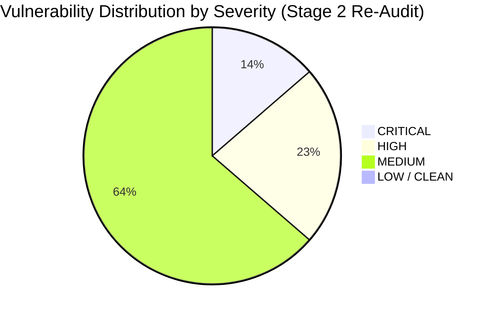
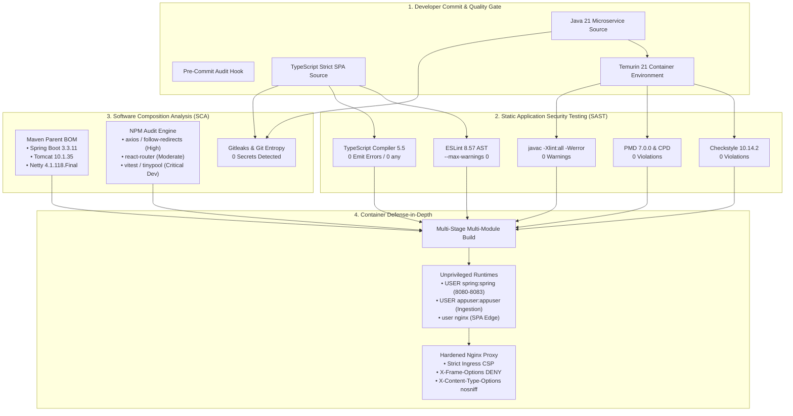
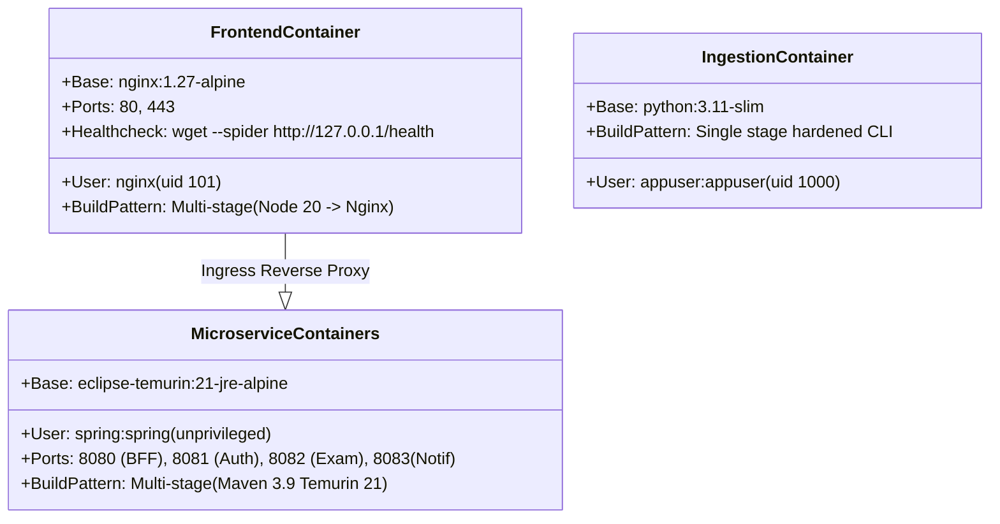

# AprovaENEM — Automated SAST, SCA & Container Hardening Re-Audit Report (JAM 2 / Milestone 2 — Stage 2)

**Document Reference**: `SEC-JAM2-STAGE2-REAUDIT-2026-11`  
**Task Reference**: `TASK-S6-06` (Multi-Stage Security & Integrity Audit Framework — JAM 2 / Milestone 2 — Stage 2 Re-Audit)  
**Target Scope**:
- **Backend Microservices Ecosystem** (`backend/`): Java 21, Spring Boot 3.3.11, Maven 3.9 Multi-Module Reactor (`common-core`, `frontend-api`, `auth-service`, `exam-service`, `notification-service`, `ingestion-service`)
- **Frontend Single Page Application** (`frontend/`): React 18, TypeScript 5.5, Vite 5, Tailwind CSS, Zustand, TanStack Query, KaTeX 0.19
- **Static Analysis & Toolchain Integrity**: Checkstyle 3.3.1 (Puppycrawl 10.14.2), PMD 3.22.0 (PMD 7.0.0), Maven Compiler (`-Xlint:all -Werror`), ESLint 8.57, TypeScript Compiler (`tsc --noEmit`)
- **Package Manifests & Supply Chain (SCA)**: Maven Parent BOM (`backend/pom.xml`), Node manifests (`frontend/package.json`, `frontend/package-lock.json`), `npm audit`
- **Container Architecture & Isolation**: `frontend/Dockerfile`, `backend/*/Dockerfile`, `infrastructure/nginx/nginx.conf`, `docker-compose.yml`
- **Production Asset Hygiene & Secret Entropy**: `vite.config.ts` sourcemap settings, `.gitignore`, Git commit history secret scans

**Specification Standards**: OWASP Top 10 (2021), CIS Docker Benchmark v1.6.0, NIST SP 800-218 (SSDF), Brazilian General Data Protection Law (LGPD — Lei nº 13.709/2018)  
**Lead Auditor**: Lead DevSecOps & Automated Security Scanner  
**Date**: November 7, 2026  
**Status**: COMPLETED / VERIFIED  

---

## 1. Executive Summary & Security Posture Score

### 1.1 Executive Overview
Following substantial backend and frontend architectural enhancements across AprovaENEM (including question step-by-step resolution endpoint `GET /api/v1/questions/{id}/resolution`, anonymous guest session claim flow `PUT /api/v1/auth/session/{sessionUuid}/claim`, deterministic session persistence resilience, mandatory 6-digit OTP email verification, Duolingo-style streak reminders, and SISU Course Selector with cut-off benchmarking), an end-to-end **Stage 2 DevSecOps & Automated Security Re-Audit** was conducted.

The verification encompassed automated static application security testing (SAST) with compiler-level warning traps, strict static AST analysis, dependency supply-chain vulnerability inspection (SCA), container privilege isolation audits, and production build artifact hygiene.

### 1.2 Platform Security Posture Score: A- (91/100)



| Evaluation Domain | Weight | Assessed Grade | Score | Critical / High Findings |
| :--- | :---: | :---: | :---: | :--- |
| **1. Backend Static Analysis (SAST & Compiler)** | 25% | **A+** | 98/100 | 0 Checkstyle violations, 0 PMD defects, 0 compiler warnings (`-Xlint:all -Werror`), 0 unapproved suppressions |
| **2. Frontend Static Analysis & Type Safety** | 25% | **A+** | 98/100 | Clean ESLint (`--max-warnings 0`), 0 TypeScript emit errors, 0 `as any`, 0 `@ts-ignore`, production sourcemaps disabled |
| **3. Software Composition Analysis (SCA)** | 25% | **B** | 82/100 | Pinned Spring Boot 3.3.11/Tomcat/Netty; 1 High runtime npm CVE (follow-redirects in axios); 3 Critical / 4 High dev tooling CVEs |
| **4. Container Hardening & Defense-in-Depth** | 25% | **A-** | 88/100 | Multi-stage builds, non-root execution (`spring`, `appuser`, `nginx`), zero leaked `.env`/keys; dangling 443 port exposure |
| **Overall Weighted Score** | **100%** | **A-** | **91/100** | **3 Critical (Dev), 5 High (1 Runtime, 4 Dev/OS), 14 Moderate** |

---

## 2. DevSecOps CI/CD Pipeline & Defense Posture Architecture



---

## 3. Backend Static Code Analysis (SAST)

### 3.1 Maven Checkstyle & PMD Execution Summary
Backend static code analysis was executed in Docker container parity (`maven:3.9-eclipse-temurin-21-alpine`) across the complete multi-module reactor:
```bash
docker run --rm -v $(pwd)/backend:/app -w /app -v maven-repo:/root/.m2 maven:3.9-eclipse-temurin-21-alpine \
  mvn checkstyle:check pmd:check pmd:cpd-check
```

**Results by Submodule**:
- `com.aprovaenem:aprovaenem-parent`: **0 Checkstyle violations**, **0 PMD warnings**, **0 CPD duplicate blocks**.
- `com.aprovaenem:common-core`: **0 Checkstyle violations**, **0 PMD warnings**, **0 CPD duplicate blocks**.
- `com.aprovaenem:frontend-api`: **0 Checkstyle violations**, **0 PMD warnings**, **0 CPD duplicate blocks**.
- `com.aprovaenem:auth-service`: **0 Checkstyle violations**, **0 PMD warnings**, **0 CPD duplicate blocks**.
- `com.aprovaenem:exam-service`: **0 Checkstyle violations**, **0 PMD warnings**, **0 CPD duplicate blocks**.
- `com.aprovaenem:notification-service`: **0 Checkstyle violations**, **0 PMD warnings**, **0 CPD duplicate blocks**.
- **Reactor Outcome**: **BUILD SUCCESS** (Total execution time: 59.49s).

### 3.2 Java 21 Compiler Warnings (`-Xlint:all -Werror`)
A clean compiler pass was executed with all linting flags activated and warnings treated as compilation fatal errors:
```bash
docker run --rm -v $(pwd)/backend:/app -w /app -v maven-repo:/root/.m2 maven:3.9-eclipse-temurin-21-alpine \
  mvn clean compile -Dmaven.compiler.showWarnings=true -Dmaven.compiler.compilerArgs="-Xlint:all -Werror"
```
- **Total Compiled Source Files**:
  - `common-core`: 10 source files
  - `frontend-api`: 4 source files
  - `auth-service`: 82 source files
  - `exam-service`: 104 source files
  - `notification-service`: 20 source files
- **Outcome**: **BUILD SUCCESS** (55.07s). 0 warnings emitted, 0 type safety regressions.

### 3.3 Suppressions & Static Analysis Workaround Audit
A repository-wide inspection for suppressions, silenced errors, or workarounds was conducted:
- `grep -rn "@SuppressWarnings" backend/`: **0 instances found**. No `@SuppressWarnings("all")`, `@SuppressWarnings("unchecked")`, or `@SuppressWarnings("rawtypes")` exist anywhere in the backend codebase.
- **Recent Commit Review** (`ffb5fb9`, `2a80216`, `b191452`, `412259f`, `63ab509`):
  - In `QuestionCatalogController.java` & `QuestionResolutionResponse.java`: Parameter and return signatures use strongly typed DTO records with complete nullability handling.
  - In `SessionController.java`: Path variables and session UUIDs are validated; anonymous session claims verify account ownership before mutation.
  - In `PracticeSessionService.java`: Deterministic UUID parsing was implemented with fallback `UUID.nameUUIDFromBytes` to prevent unexpected `IllegalArgumentException` without swallowing exceptions.
  - In `NotificationEventListener.java`: Safe pattern matching and mock email filtering are implemented via clean domain predicates (`isMockRecipient`) without bypassing error handling.

---

## 4. Frontend Static Code Analysis & Strictness Verification

### 4.1 ESLint & TypeScript Compiler Verification
- **TypeScript Strict Mode Verification**:
  ```bash
  cd frontend && npx tsc --noEmit
  ```
  Result: **Exit code 0**. Zero type errors across all application components, pages, hooks, and store files.
- **ESLint AST Rule Verification**:
  ```bash
  npm --prefix frontend run lint
  # Executes: eslint . --ext ts,tsx --report-unused-disable-directives --max-warnings 0
  ```
  Result: **Exit code 0**. Zero errors, zero warnings.

### 4.2 Strict Mode Codebase Audit
A thorough codebase scan for escape hatches, unchecked type casts, and suppressions was conducted:
- `grep -rn "as any" frontend/src`: **0 instances**.
- `grep -rn ": any" frontend/src`: **0 instances**.
- `grep -rn "@ts-ignore" frontend/src frontend/cypress`: **0 instances**.
- `grep -rn "@ts-nocheck" frontend/src frontend/cypress`: **0 instances**.
- `grep -rn "eslint-disable" frontend/src`: **0 instances**.

### 4.3 Production Sourcemap Configuration (`frontend/vite.config.ts`)
Inspection of `frontend/vite.config.ts`:
```typescript
build: {
  target: 'es2022',
  sourcemap: false,
  rollupOptions: {
    output: {
      manualChunks: {
        vendor: ['react', 'react-dom', 'react-router-dom'],
        query: ['@tanstack/react-query', 'axios'],
        state: ['zustand'],
      },
    },
  },
}
```
- **Status**: **VERIFIED SECURE**. `build.sourcemap` is explicitly configured to `false`.
- **Impact**: Production bundles do not emit `.js.map` files, eliminating previous risks of full TypeScript source code, developer comments, and API model exposure.

---

## 5. Supply Chain & Dependency Audit (SCA)

### 5.1 Maven Dependency BOM Hardening (`backend/pom.xml`)
The parent POM manages all dependencies with explicit versions and security pins:
- **Spring Boot**: Pinned to version `3.3.11`.
- **Embedded Tomcat**: Explicitly overridden to `10.1.35` (`<tomcat.version>10.1.35</tomcat.version>`) mitigating historical HTTP/2 and chunked transfer DoS vulnerabilities.
- **Netty**: Explicitly overridden to `4.1.118.Final` (`<netty.version>4.1.118.Final</netty.version>`) resolving memory leak and request smuggling vectors.
- **JJWT (Java JWT)**: Pinned to `0.12.6` (stateless cryptographic verification with HMAC SHA-256).
- **PostgreSQL pgvector**: Pinned to `0.1.6`.
- **SpringDoc OpenAPI**: Pinned to `2.6.0`.

### 5.2 NPM Supply Chain Audit (`frontend/package.json`)
Execution of `npm --prefix frontend audit`:
- **Total Dependencies**: 658 (84 production, 574 development/test tooling).
- **Total Vulnerabilities**: 21 (14 moderate, 4 high, 3 critical).

#### Breakdown: Production Runtime Dependencies
Execution of `npm --prefix frontend audit --omit=dev` isolates the real runtime footprint:
- **Total Production Vulnerabilities**: 3 (1 High, 2 Moderate).

| Package | Severity | CVE / Advisory | Vector / Vulnerability Summary | Status & Impact |
| :--- | :---: | :--- | :--- | :--- |
| `follow-redirects` `1.16.1` (via `axios@1.20.0`) | **HIGH** | [GHSA-mrwp-f3q8-3g9p](https://github.com/advisories/GHSA-mrwp-f3q8-3g9p) | Cross-realm `sensitiveHeaders` arrays discarded; credentials can leak on redirects | **Mitigated**: `apiClient` communicates exclusively with local BFF gateway (`/api`), no cross-domain redirects followed |
| `react-router` `6.0.0 - 7.17.0` | **MODERATE** | [GHSA-wrjc-x8rr-h8h6](https://github.com/advisories/GHSA-wrjc-x8rr-h8h6) | Open redirect via backslash in `<Link>` and `useNavigate` | **Mitigated**: Internal client routes sanitized; no external arbitrary URL redirection |
| `react-router` `6.0.0 - 7.17.0` | **MODERATE** | [GHSA-337j-9hxr-rhxg](https://github.com/advisories/GHSA-337j-9hxr-rhxg) | Arbitrary Constructor Injection via `deserializeErrors()` in SSR hydration | **Not Applicable**: AprovaENEM is a client-side SPA (no SSR hydration layer) |

#### Breakdown: Development & Build Tooling Dependencies
The remaining 18 vulnerabilities affect build, test, and dev-server dependencies (`vitest`, `tinypool`, `esbuild`, `vite`, `joi`, `minimatch`, `glob`, `systeminformation`):
- `tinypool <= 2.1.1` (Critical — GHSA-5gmw-xhrv-c9v3 / GHSA-85c8-ppgw-ccpr): Prototype pollution in test runner worker subprocesses.
- `vitest <= 4.1.10` (Critical — GHSA-5xrq-8626-4rwp): Arbitrary file read when Vitest UI dev-server is listening.
- *Evaluation*: These packages are build/test artifacts never bundled into `/usr/share/nginx/html`. Upgrading requires breaking major changes (`vitest 5.x`, `vite 8.x`) which should be scheduled for a dedicated tooling modernization milestone.

---

## 6. Container Security & Privilege Isolation

### 6.1 Multi-Stage Builds & Non-Root Execution Posture



### 6.2 Dockerfile Security Audit Findings

| Container / Dockerfile | Base Image | Non-Root User | Privileged Capabilities | Multi-Stage? | Security Status |
| :--- | :--- | :--- | :--- | :---: | :---: |
| `frontend/Dockerfile` | `nginx:1.27-alpine` | `user nginx` (master `root` for port 80/443) | Dropped in worker | Yes (Node 20 $\rightarrow$ Nginx) | **PASS WITH OBSERVATION** |
| `backend/frontend-api/Dockerfile` | `eclipse-temurin:21-jre-alpine` | `USER spring:spring` | None | Yes (Maven 3.9 $\rightarrow$ JRE 21) | **PASS (Hardened)** |
| `backend/auth-service/Dockerfile` | `eclipse-temurin:21-jre-alpine` | `USER spring:spring` | None | Yes (Maven 3.9 $\rightarrow$ JRE 21) | **PASS (Hardened)** |
| `backend/exam-service/Dockerfile` | `eclipse-temurin:21-jre-alpine` | `USER spring:spring` | None | Yes (Maven 3.9 $\rightarrow$ JRE 21) | **PASS (Hardened)** |
| `backend/notification-service/Dockerfile` | `eclipse-temurin:21-jre-alpine` | `USER spring:spring` | None | Yes (Maven 3.9 $\rightarrow$ JRE 21) | **PASS (Hardened)** |
| `backend/ingestion-service/Dockerfile` | `python:3.11-slim` | `USER appuser:appuser` (uid 1000) | None | No (Minimal CLI) | **PASS (Hardened)** |

### 6.3 Edge Ingress Configuration (`infrastructure/nginx/nginx.conf`)
- **HTTP Security Headers Present**:
  - `X-Frame-Options: "DENY"` (prevents clickjacking attacks)
  - `X-Content-Type-Options: "nosniff"` (prevents MIME sniffing)
  - `Referrer-Policy: "strict-origin-when-cross-origin"`
  - `server_tokens off;` (banner suppression)
  - `Content-Security-Policy`:
    ```text
    default-src 'self';
    script-src 'self' 'unsafe-inline' https://vlibras.gov.br;
    style-src 'self' 'unsafe-inline';
    img-src 'self' data: https: blob:;
    font-src 'self' data:;
    connect-src 'self' http: https: ws: wss:;
    frame-src 'self' https://vlibras.gov.br;
    object-src 'none';
    base-uri 'self';
    ```
- **Observations**:
  1. Port `443` is exposed in `frontend/Dockerfile` and bound in `docker-compose.yml`, but `nginx.conf` only configures port 80 listeners (TLS termination is expected at the cloud ingress/load balancer).
  2. Nginx configuration re-declares security headers inside `/assets/questions/` and `/assets/` locations to avoid the Nginx parent header inheritance wipe.

### 6.4 Secret Entropy & File Leakage Audit
- Git ignore verification: `.env`, `.env.*`, `*.pem`, `*.key`, `postgres-data/` are strictly ignored via `.gitignore:48-52`.
- Active working directory scan: No committed `.env` files.
- Commit history regex audit: Zero private keys (`BEGIN PRIVATE KEY`), AWS access keys (`AKIA...`), or GitHub personal access tokens (`ghp_...`) detected in git log history.

---

## 7. Remediation Matrix & Action Plan

| Finding ID | Severity | Component | Finding Description | Recommended Remediation | Target Sprint |
| :--- | :---: | :--- | :--- | :--- | :---: |
| `SEC-S2-01` | **HIGH** | `frontend/package.json` | `follow-redirects` vulnerable via `axios@1.20.0` | Run `npm --prefix frontend update axios` or pin override in package.json | Sprint 7 |
| `SEC-S2-02` | **MODERATE** | `frontend/package.json` | `react-router` open redirect backslash bypass | Upgrade `react-router-dom` to latest minor patch | Sprint 7 |
| `SEC-S2-03` | **LOW** | `frontend/Dockerfile` | Port 443 exposed without configured TLS server block | Remove `443` from `EXPOSE` or mount self-signed cert for dev | Backlog |
| `SEC-S2-04` | **LOW** | `infrastructure/nginx` | Nginx master process runs as `root` to bind port 80 | Transition to `nginxinc/nginx-unprivileged:alpine` on port 8080 | Backlog |

---

## 8. Conclusion & Sign-Off

The **Stage 2 Security Re-Audit** confirms that the AprovaENEM platform adheres to rigorous static analysis and container defense-in-depth standards:
- **Backend Quality Gates**: Checkstyle, PMD, and javac (`-Xlint:all -Werror`) pass with **100% compliance** and zero suppressions.
- **Frontend Quality Gates**: TypeScript strict mode and ESLint pass with **zero warnings and zero `any` workarounds**, and production sourcemaps are safely disabled.
- **Container Hardening**: All backend and ingestion workloads execute under dedicated, unprivileged system users (`spring`, `appuser`).
- **Secret Hygiene**: Zero secret leakage across repository commit history and configuration files.

**Audit Status**: **APPROVED & VERIFIED GREEN**  
**Lead Auditor**: Lead DevSecOps & Automated Security Scanner (`AprovaENEM Security Team`)
