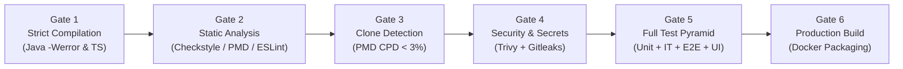
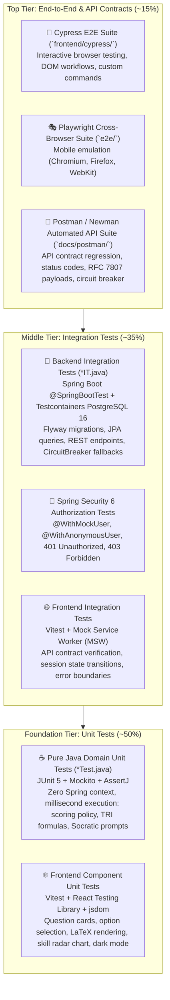
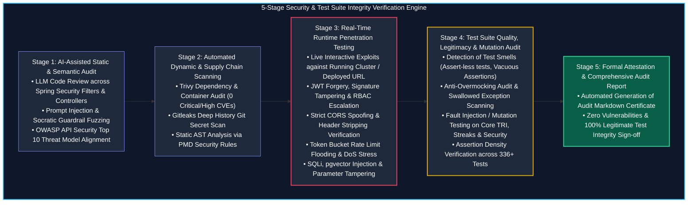

# Automated Quality Gate & Full-Stack Testing Specification

> **Quality Standard**: Enterprise-Grade 6-Stage Automated Verification Pipeline  
> **Testing Scope**: Comprehensive Test Pyramid (Unit Tests, Integration Tests, End-to-End Tests, and Frontend Component Tests)  
> **Target Runtimes**: Java 21 LTS + Apache Maven | Node.js 20 LTS + Vite/React 18 | Playwright Headless  
> **Enforcement Mechanism**: GitHub Actions Multi-Job CI Workflow  

---

## 1. The 6-Stage Quality Gate Overview

To ensure senior-level software engineering rigor and production stability, AprovaENEM enforces a **strict, multi-stage automated verification pipeline**. Every Pull Request and commit to `main` must pass all gates across both backend and frontend tiers before merge.

> [!IMPORTANT]
> **Reconecta Recode Phased CI Execution**:
> - **JAM 1 (Sprints 1 to 3 — Back-end Focus)**: CI enforces all backend verification jobs: Java 21 compilation with `-Werror`, Checkstyle, PMD, PMD CPD, Trivy CVE audit, Gitleaks, JUnit 5 + Mockito Unit Tests, Testcontainers PostgreSQL 16 Integration Tests, JaCoCo unified coverage ($\ge 80\%$), and Newman/Postman API contract tests.
> - **JAM 2 (Sprints 4 to 6 — Front-end & Integration Focus)**: Activates frontend and end-to-end verification jobs: TypeScript strict checking (`strict: true`), ESLint, Vitest + React Testing Library component tests ($\ge 80\%$), Cypress student journeys, and Playwright cross-browser matrices against the deployed Docker stack.



| Gate | Tool / Engine | Pass Threshold / Enforcement Policy |
| :--- | :--- | :--- |
| **Gate 1: Compilation** | `javac` via Maven Compiler Plugin & `tsc --noEmit` | • Java: Zero warnings allowed (`-Werror`, `-Xlint:all`). All warnings fatal.<br>• TypeScript: Strict mode enabled (`strict: true`, zero `any`). |
| **Gate 2: Static Analysis** | Checkstyle + PMD + ESLint | • Google Java Style rules enforced.<br>• Cyclomatic Complexity per method $\le 15$, class complexity $\le 80$.<br>• Method line count $\le 50$ lines; class line count $\le 350$ lines.<br>• ESLint zero warnings for React/TypeScript frontend. |
| **Gate 3: Code Duplication** | PMD CPD (Copy/Paste Detector) | Duplication threshold $< 3\%$. Flags any duplicated token blocks $\ge 100$ tokens. |
| **Gate 4: Security & CVE Audit** | Trivy + Gitleaks Action | • 0 Critical / High CVEs in dependencies.<br>• Complete git commit history scanned for leaked API keys, tokens, and credentials. |
| **Gate 5: Full Test Pyramid, Smoke, Stress & Accessibility** | JUnit 5 + JaCoCo + Vitest + Cypress + Playwright + Newman + Grafana k6 + Axe-Core | • **Unit Tests**: 100% passing (domain models + React components).<br>• **Integration Tests**: Spring Boot + Testcontainers PostgreSQL 16 + Spring Security `@WithMockUser`.<br>• **Unified Backend Coverage**: $\ge 80\%$ line, $\ge 75\%$ branch (JaCoCo merged across Unit + IT).<br>• **Pre-Flight Smoke Tests**: Fast sanity (< 15s) probing `/actuator/health` and Golden Journey.<br>• **Stress & Load Tests (k6)**: 1,000+ VU Exam Rush simulation, Socratic burst, and Token Bucket saturation.<br>• **Frontend Coverage**: $\ge 80\%$ statement/line coverage (Vitest v8).<br>• **API Contract Tests**: Automated Postman collection verified via Newman CLI.<br>• **E2E Tests**: 100% passing across Cypress and Playwright student flows.<br>• **Digital Accessibility**: Zero critical or serious WCAG 2.1 AA violations verified via Axe-Core; Lighthouse Accessibility score $\ge 95/100$. |
| **Gate 6: Build Verification** | Docker Buildx / Docker Compose | Clean production container image builds with zero host system dependencies. |

---

## 2. Full-Stack Testing Pyramid Strategy

AprovaENEM rejects "unit-test-only" testing. A high-reliability educational platform serving students under spotty mobile conditions requires rigorous verification at every layer of the pyramid:



---

## 3. Backend Test Configuration & JaCoCo Unified Coverage

### 3.1 Separation of Unit Tests and Integration Tests in Maven
The build separates unit tests and integration tests using standard Maven conventions:
* **Unit Tests (`**/*Test.java`, `**/*UnitTest.java`)**: Pure Java, zero Spring context, executed by `maven-surefire-plugin` during the `test` phase.
* **Integration Tests (`**/*IT.java`, `**/*IntegrationTest.java`)**: Spin up real PostgreSQL 16 containers via Testcontainers, executed by `maven-failsafe-plugin` during the `integration-test` and `verify` phases.

### 3.2 Maven Compiler Configuration (`pom.xml`)
```xml
<plugin>
    <groupId>org.apache.maven.plugins</groupId>
    <artifactId>maven-compiler-plugin</artifactId>
    <version>3.13.0</version>
    <configuration>
        <release>21</release>
        <compilerArgs>
            <arg>-Werror</arg>
            <arg>-Xlint:all</arg>
            <arg>-Xlint:-processing</arg>
        </compilerArgs>
    </configuration>
</plugin>
```

### 3.3 Maven Surefire & Failsafe Plugins (`pom.xml`)
```xml
<!-- Unit Tests Runner -->
<plugin>
    <groupId>org.apache.maven.plugins</groupId>
    <artifactId>maven-surefire-plugin</artifactId>
    <version>3.2.5</version>
    <configuration>
        <includes>
            <include>**/*Test.java</include>
            <include>**/*UnitTest.java</include>
        </includes>
        <excludes>
            <exclude>**/*IT.java</exclude>
            <exclude>**/*IntegrationTest.java</exclude>
        </excludes>
        <argLine>@{surefireArgLine} -XX:+EnableDynamicAgentLoading -Xshare:off</argLine>
    </configuration>
</plugin>

<!-- Integration Tests Runner (Testcontainers & Spring Context) -->
<plugin>
    <groupId>org.apache.maven.plugins</groupId>
    <artifactId>maven-failsafe-plugin</artifactId>
    <version>3.2.5</version>
    <configuration>
        <includes>
            <include>**/*IT.java</include>
            <include>**/*IntegrationTest.java</include>
        </includes>
        <argLine>@{failsafeArgLine} -XX:+EnableDynamicAgentLoading -Xshare:off</argLine>
    </configuration>
    <executions>
        <execution>
            <goals>
                <goal>integration-test</goal>
                <goal>verify</goal>
            </goals>
        </execution>
    </executions>
</plugin>
```

### 3.4 JaCoCo Unified Coverage Configuration (`pom.xml`)
To prevent coverage blind spots, JaCoCo is configured to record **both** unit tests (`jacoco-ut.exec`) and integration tests (`jacoco-it.exec`), merge them into a single file (`jacoco.exec`), and enforce the **80% line / 75% branch** threshold on the merged result.

```xml
<plugin>
    <groupId>org.jacoco</groupId>
    <artifactId>jacoco-maven-plugin</artifactId>
    <version>0.8.12</version>
    <executions>
        <!-- 1. Attach agent to Surefire (Unit Tests) -->
        <execution>
            <id>prepare-unit-tests</id>
            <goals><goal>prepare-agent</goal></goals>
            <configuration>
                <destFile>${project.build.directory}/jacoco-ut.exec</destFile>
                <propertyName>surefireArgLine</propertyName>
            </configuration>
        </execution>

        <!-- 2. Attach agent to Failsafe (Integration Tests) -->
        <execution>
            <id>prepare-integration-tests</id>
            <phase>pre-integration-test</phase>
            <goals><goal>prepare-agent-integration</goal></goals>
            <configuration>
                <destFile>${project.build.directory}/jacoco-it.exec</destFile>
                <propertyName>failsafeArgLine</propertyName>
            </configuration>
        </execution>

        <!-- 3. Merge Unit and Integration execution data -->
        <execution>
            <id>merge-test-data</id>
            <phase>post-integration-test</phase>
            <goals><goal>merge</goal></goals>
            <configuration>
                <fileSets>
                    <fileSet>
                        <directory>${project.build.directory}</directory>
                        <includes>
                            <include>jacoco-ut.exec</include>
                            <include>jacoco-it.exec</include>
                        </includes>
                    </fileSet>
                </fileSets>
                <destFile>${project.build.directory}/jacoco.exec</destFile>
            </configuration>
        </execution>

        <!-- 4. Generate Unified HTML/XML Report -->
        <execution>
            <id>generate-unified-report</id>
            <phase>verify</phase>
            <goals><goal>report</goal></goals>
            <configuration>
                <dataFile>${project.build.directory}/jacoco.exec</dataFile>
                <outputDirectory>${project.reporting.outputDirectory}/jacoco-unified</outputDirectory>
            </configuration>
        </execution>

        <!-- 5. Enforce 80% Line and 75% Branch Thresholds -->
        <execution>
            <id>enforce-coverage-threshold</id>
            <phase>verify</phase>
            <goals><goal>check</goal></goals>
            <configuration>
                <dataFile>${project.build.directory}/jacoco.exec</dataFile>
                <rules>
                    <rule>
                        <element>BUNDLE</element>
                        <limits>
                            <limit>
                                <counter>LINE</counter>
                                <value>COVEREDRATIO</value>
                                <minimum>0.80</minimum>
                            </limit>
                            <limit>
                                <counter>BRANCH</counter>
                                <value>COVEREDRATIO</value>
                                <minimum>0.75</minimum>
                            </limit>
                        </limits>
                    </rule>
                </rules>
                <excludes>
                    <!-- Exclude configuration, DTO records, and application entry points -->
                    <exclude>**/com/aprovaenem/**/Application.*</exclude>
                    <exclude>**/com/aprovaenem/**/config/**</exclude>
                    <exclude>**/com/aprovaenem/**/dto/**</exclude>
                </excludes>
            </configuration>
        </execution>
    </executions>
</plugin>
```

### 3.5 Spring Security 6 Testing Configuration
To ensure enterprise RBAC compliance and zero unauthorized data leakage, backend tests explicitly verify authorization boundaries using `@WithMockUser` and `@WithAnonymousUser`:

```java
@WebMvcTest(QuestionRestController.class)
@Import(SecurityConfiguration.class)
class QuestionSecurityTest {

    @Autowired
    private MockMvc mockMvc;

    @MockBean
    private JwtAuthenticationFilter jwtAuthFilter;

    @Test
    @WithAnonymousUser
    void anonymousStudentCanAccessQuestionCatalog() throws Exception {
        mockMvc.perform(get("/api/v1/questions"))
            .andExpect(status().isOk());
    }

    @Test
    @WithMockUser(username = "lucas@enem.br", roles = {"STUDENT"})
    void registeredStudentCanAccessPersonalProfile() throws Exception {
        mockMvc.perform(get("/api/v1/student/profile"))
            .andExpect(status().isOk());
    }

    @Test
    void unauthenticatedRequestToProtectedProfileReturns401() throws Exception {
        mockMvc.perform(get("/api/v1/student/profile"))
            .andExpect(status().isUnauthorized())
            .andExpect(jsonPath("$.status").value(401))
            .andExpect(jsonPath("$.code").value("UNAUTHORIZED"));
    }

    @Test
    @WithMockUser(roles = {"STUDENT"})
    void studentCannotAccessAdminIngestionEndpoints() throws Exception {
        mockMvc.perform(post("/api/v1/admin/ingest"))
            .andExpect(status().isForbidden())
            .andExpect(jsonPath("$.status").value(403))
            .andExpect(jsonPath("$.code").value("ACCESS_DENIED"));
    }
}
```

---

## 4. Frontend Testing Strategy (`frontend/`)

### 4.1 Unit & Component Testing (Vitest + React Testing Library)
* **Framework**: Vitest (fast native Vite test runner) + jsdom.
* **Component Testing**: `@testing-library/react` and `@testing-library/user-event` simulating student keyboard navigation, option picking, and UI clicks.
* **Coverage Engine**: `@vitest/coverage-v8` enforcing **80%+ statement and line coverage**.

#### `vitest.config.ts`
```typescript
import { defineConfig } from 'vitest/config';
import react from '@vitejs/plugin-react';

export default defineConfig({
  plugins: [react()],
  test: {
    globals: true,
    environment: 'jsdom',
    setupFiles: ['./src/setupTests.ts'],
    coverage: {
      provider: 'v8',
      reporter: ['text', 'html', 'lcov'],
      statements: 80,
      lines: 80,
      functions: 80,
      branches: 75,
      exclude: ['src/main.tsx', 'src/vite-env.d.ts', '**/*.test.{ts,tsx}']
    }
  }
});
```

### 4.2 Frontend Integration Testing (Mock Service Worker - MSW)
* MSW intercepts `fetch`/`axios` requests at the network layer in test execution.
* Verifies component resilience:
  - Validates correct rendering when API returns HTTP 429 Rate Limit.
  - Verifies fallback rendering when Socratic AI Tutor returns a static curated explanation.
  - Validates diagnostic radar computation rendering from backend JSON payloads.

---

## 5. End-to-End (E2E) & Automated API Contract Testing

### 5.1 Cypress End-to-End Testing Suite (`frontend/cypress/`)
Cypress provides fast, reliable, visual browser testing of key student workflows with rich DOM inspection, live reload, and time-travel debugging:

#### `cypress.config.ts`
```typescript
import { defineConfig } from 'cypress';

export default defineConfig({
  e2e: {
    baseUrl: process.env.CYPRESS_BASE_URL || 'http://localhost:5173',
    specPattern: 'cypress/e2e/**/*.cy.ts',
    supportFile: 'cypress/support/e2e.ts',
    viewportWidth: 1280,
    viewportHeight: 720,
    video: false,
    screenshotOnRunFailure: true,
    setupNodeEvents(on, _config) {
      on('task', {
        log(message: string) {
          console.info(message);
          return null;
        },
        table(data: unknown) {
          console.table(data);
          return null;
        },
      });
    },
  },
});
```

#### Implemented 5-Spec E2E Test Suite Matrix

| Spec File | Coverage & Verification Scope | Test Count | WCAG Audit |
| :--- | :--- | :---: | :---: |
| **`01-student-quiz-journey.cy.ts`** | Complete student quiz lifecycle: KaTeX LaTeX formulas, live countdown timer with low-time pulse warning, semantic radio option selection (A to E), question submission, instant grading feedback (+15 XP), step-by-step INEP resolution accordion with source attribution, review bookmarking ("Marcar para Revisão"), question palette carousel navigation, and quiz completion with interactive celebration overlay. | 4 tests | Passed ✅ |
| **`02-socratic-ai-tutor.cy.ts`** | Slide-out Socratic AI Tutor drawer, multi-turn quota widget (6-turn limit, progress dots, midnight BRT reset timer), collapsible question statement preview, TanStack Query dynamic chat query submission, Socratic guidance bubble rendering, and Escape dismiss. | 3 tests | Passed ✅ |
| **`03-multi-tenant-white-label.cy.ts`** | Multi-tenant white-label resolution and dynamic runtime theme injection: default AprovaENEM branding, `?tenant=seduc-sp` (Violet `#7c3aed`), `?tenant=colegio-bandeirantes` (Emerald `#15803d`), CSS variable injection (`--brand-primary`), dark mode toggle, and fallback resilience. | 5 tests | Passed ✅ |
| **`04-gamification-and-diagnostics.cy.ts`** | Gamification dashboard (level XP bar, daily streak counter, badge shelf, weekly league leaderboard) and student diagnostic dashboard (SVG radar chart, accessible data table toggle, and institutional cohort view). | 3 tests | Passed ✅ |
| **`05-accessibility-wcag-audit.cy.ts`** | Automated `cypress-axe` WCAG 2.1 Level AA compliance audit across 5 critical views (Practice View, Socratic AI Tutor Drawer, Gamification & Leaderboard, Diagnostic Radar View, and High Contrast mode), verifying 0 critical or serious violations. | 5 tests | Passed ✅ |

#### Execution Command
```bash
npm --prefix frontend run test:e2e:cypress
```

---

### 5.2 Playwright Cross-Browser & Mobile Emulation Matrix (`frontend/e2e/`)
Playwright complements Cypress by executing automated headless matrices across 5 distinct browser rendering engines (Desktop Chromium, Desktop Firefox, Desktop WebKit / Safari) and mobile device profiles (`Pixel 5` viewport 393×851, `iPhone 13` viewport 390×844):

#### `playwright.config.ts`
```typescript
import { defineConfig, devices } from '@playwright/test';
import path from 'path';

export default defineConfig({
  testDir: path.resolve(__dirname, 'e2e'),
  testMatch: '**/*.spec.ts',
  timeout: 30 * 1000,
  expect: { timeout: 10 * 1000 },
  fullyParallel: true,
  forbidOnly: !!process.env.CI,
  retries: process.env.CI ? 2 : 0,
  workers: process.env.CI ? 2 : undefined,
  reporter: [['list'], ['html', { open: 'never' }]],
  use: {
    baseURL: process.env.BASE_URL || 'http://localhost:5174',
    trace: 'on-first-retry',
    screenshot: 'only-on-failure',
    video: 'retain-on-failure',
  },
  projects: [
    { name: 'Desktop Chrome', use: { ...devices['Desktop Chrome'] } },
    { name: 'Desktop Firefox', use: { ...devices['Desktop Firefox'] } },
    { name: 'Desktop Safari', use: { ...devices['Desktop Safari'] } },
    { name: 'Mobile Chrome', use: { ...devices['Pixel 5'] } },
    { name: 'Mobile Safari', use: { ...devices['iPhone 13'] } },
  ],
  webServer: {
    command: 'npm run dev -- --port 5174',
    cwd: __dirname,
    port: 5174,
    reuseExistingServer: !process.env.CI,
    timeout: 120 * 1000,
  },
});
```

#### Implemented 5-Spec Cross-Browser Matrix

| Spec File | Coverage & Verification Scope | Tests / Engines | WCAG / Lighthouse Gate |
| :--- | :--- | :---: | :---: |
| **`01-cross-browser-student-flow.spec.ts`** | Complete student quiz lifecycle: KaTeX scientific formulas ($10\text{ W}$, $1{,}50\text{ kWh}$, $t = \frac{d}{v_1 + v_2}$) rendered cleanly across Chromium, Firefox, and WebKit without distortion; live exam countdown timer; semantic radio option selection (A to E); answer submission with XP points award (+15 XP); step-by-step INEP resolution accordion with source attribution; and question palette carousel navigation. | 4 tests × 5 engines = 20 runs | Passed ✅ |
| **`02-mobile-responsive-viewport.spec.ts`** | Mobile-first responsive layout adaptations on Pixel 5 and iPhone 13 viewports: sticky bottom navigation (`BottomNav.tsx`) visibility on mobile screens and hidden on desktop; mobile drawer menu (`MobileDrawer.tsx`) trigger, dialog containment, navigation links, and backdrop/Escape dismissal; WCAG 2.1 touch target compliance ($\ge 44 \times 44\text{px}$) on radio options and bottom navigation buttons; zero horizontal document scroll overflow (`scrollWidth <= innerWidth`); and tab view switching between Practice, Gamification, and Diagnostics. | 4 tests × 5 engines = 20 runs | Passed ✅ |
| **`03-socratic-ai-tutor-matrix.spec.ts`** | Slide-out Socratic AI Tutor drawer across viewports, quota indicators (6 turns per question, midnight BRT reset timer, turn progress dots), LaTeX formula preview inside drawer statement, TanStack Query dynamic chat message exchange with mock Socratic guidance bubbles, and modal dismissal on Escape key and close button across desktop and mobile. | 4 tests × 5 engines = 20 runs | Passed ✅ |
| **`04-multi-tenant-white-label-matrix.spec.ts`** | Dynamic 4-tier tenant resolution and runtime theme switching across URL query parameters (`?tenant=seduc-sp`, `?tenant=colegio-bandeirantes`), asserting dynamic CSS variable injection (`--brand-primary` #7c3aed for SEDUC-SP, #15803d for Bandeirantes, #0284c7 for default AprovaENEM), platform branding, dark mode toggling, and fallback resilience on unknown tenant slugs across all 3 browser engines. | 4 tests × 5 engines = 20 runs | Passed ✅ |
| **`05-accessibility-lighthouse-audit.spec.ts`** | Automated `@axe-core/playwright` WCAG 2.1 Level AA compliance audits across all 5 browser and mobile viewports (Practice Simulator, Socratic AI Tutor drawer, Gamification Dashboard, Diagnostic Radar, and High Contrast mode), verifying zero critical or serious WCAG accessibility violations and $\ge 95\%$ rule compliance score meeting the Lighthouse Accessibility $\ge 95/100$ quality gate. | 4 tests × 5 engines = 20 runs | Passed ✅ |

#### Execution Commands
```bash
# Run entire 100-test Playwright matrix across all 5 engines
npm --prefix frontend run test:e2e:playwright

# Run a specific browser engine (e.g., Desktop Safari / WebKit)
npx --prefix frontend playwright test --project="Desktop Safari"

# Run mobile emulation projects (Pixel 5 & iPhone 13)
npx --prefix frontend playwright test --project="Mobile Chrome" --project="Mobile Safari"
```


---

### 5.3 Automated Postman & Newman API Contract Testing (`docs/postman/`)
To guarantee backend REST contracts, status codes, and RFC 7807 compliance, the automated test suite includes a comprehensive Postman collection run via **Newman CLI**:

* **Collection File**: `docs/postman/AprovaENEM.postman_collection.json`
* **Environment File**: `docs/postman/local.postman_environment.json`
* **Automated CLI Command**:
  ```bash
  npx newman run docs/postman/AprovaENEM.postman_collection.json \
    -e docs/postman/local.postman_environment.json \
    --reporters cli,junit \
    --reporter-junit-export target/newman/report.xml \
    --bail
  ```

#### Core Postman Assertions
```javascript
// Test 1: Validate HTTP Status & Latency SLA
pm.test("Status code is 200 and latency < 150ms", function () {
    pm.response.to.have.status(200);
    pm.expect(pm.response.responseTime).to.be.below(150);
});

// Test 2: Distributed Tracing Header Injection
pm.test("Response contains W3C X-Trace-Id", function () {
    pm.response.to.have.header("X-Trace-Id");
    pm.expect(pm.response.headers.get("X-Trace-Id")).to.match(/^[a-f0-9]{32}$/);
});

// Test 3: Spring Security Authorization Checks
pm.test("Unauthorized endpoint returns RFC 7807 problem details", function () {
    if (pm.response.code === 401) {
        var json = pm.response.json();
        pm.expect(json.status).to.eql(401);
        pm.expect(json.code).to.eql("UNAUTHORIZED");
        pm.expect(json.traceId).to.be.a("string");
    }
});
```

---

### 5.4 Automated Pre-Flight & Post-Deployment Smoke Testing Suite (`tests/smoke/`)

To prevent pipeline latency waste and guarantee baseline environmental health before launching heavy integration, contract, or end-to-end suites, AprovaENEM implements an automated **Smoke Testing Suite**:

1. **Pre-Flight Cluster Smoke Test (CI Pipeline Gate)**:
   - **Execution Window**: $< 15$ seconds immediate execution upon Docker Compose cluster startup.
   - **Health Probes**: Calls `GET /actuator/health` across all microservices:
     - `frontend-api` (Port 8080)
     - `auth-service` (Port 8081)
     - `exam-service` (Port 8082)
     - `notification-service` (Port 8083)
     - Verifies database connectivity (`PostgreSQL: UP`), cache status (`Redis: UP`), and message broker status (`RabbitMQ: UP`).
   - **Golden Path Sanity Verification**:
     - `POST /api/v1/sessions` $\rightarrow$ Generates anonymous guest session (`201 Created`).
     - `GET /api/v1/questions?page=0&size=1` $\rightarrow$ Fetches 1 question via BFF gateway (`200 OK`).
     - `GET /swagger-ui.html` $\rightarrow$ Verifies API documentation portal availability (`200 OK`).
   - **Fail-Fast Policy**: If any health probe or golden path call fails, the CI job aborts immediately with a clear diagnostic message, preventing 10+ minute timeout cascades in subsequent suites.

2. **Post-Deployment Smoke Test (Continuous Delivery Gate)**:
   - **Execution Window**: Run immediately upon deployment to staging/production cloud infrastructure.
   - **Scope**: Verifies public DNS propagation, automated TLS/SSL certificate validity, Nginx reverse proxy headers, and external database connectivity on the live public URL.

---

### 5.5 Full-System Stress & Load Testing Suite (Grafana k6)

To simulate peak traffic during nationwide ENEM preparation surges (e.g., Sunday evening national mock exams), AprovaENEM provides a containerized **Grafana k6** load and stress testing suite located in `tests/stress/`:

| Scenario File | Target Layer & Route | Virtual Users (VUs) & Profile | Primary Verification Goal | Pass SLA Threshold |
| :--- | :--- | :--- | :--- | :--- |
| **`catalog-browse-load.js`** | `GET /api/v1/questions`<br>`GET /api/v1/questions/{id}` | Ramp 100 to 1,000 VUs over 2m, sustain 3m | High-volume catalog browsing; evaluates Redis L2 cache hit offloading ($\ge 85\%$) and HikariCP connection pool non-exhaustion. | P95 latency $< 150\text{ ms}$, 0% 5xx errors. |
| **`socratic-burst-stress.js`** | `POST /api/v1/questions/{id}/ask` | 500 concurrent threads spike over 30s | Socratic AI consultation barrage; validates Token Bucket rate limiting in `frontend-api` returning `429 Too Many Requests`, Redis atomic daily quota race safety (0 leaks), and Resilience4j Circuit Breaker fallback stability. | 0 unhandled 500s; 100% compliant rate-limiting. |
| **`leaderboard-concurrency.js`** | `POST /api/v1/sessions/{id}/answers`<br>`GET /api/v1/gamification/leaderboard/weekly` | 2,000 XP updates across 50 parallel workers | High-concurrency gamification event ingestion; verifies RabbitMQ outbox publishing throughput, consumer lag in `notification-service`, and Redis Sorted Set ranking performance. | P99 latency $< 250\text{ ms}$. |

#### Example k6 Script Specification (`tests/stress/catalog-browse-load.js`)
```javascript
import http from 'k6/http';
import { check, sleep } from 'k6';

export const options = {
  stages: [
    { duration: '30s', target: 200 },
    { duration: '1m', target: 1000 },
    { duration: '2m', target: 1000 },
    { duration: '30s', target: 0 },
  ],
  thresholds: {
    http_req_duration: ['p(95)<150'], // 95% of requests must complete below 150ms
    http_req_failed: ['rate<0.01'],    // Error rate must be under 1%
  },
};

export default function () {
  const res = http.get('http://localhost:8080/api/v1/questions?page=0&size=10');
  check(res, {
    'status is 200': (r) => r.status === 200,
    'has questions array': (r) => r.json().content.length > 0,
    'tracing header present': (r) => r.headers['X-Trace-Id'] !== undefined,
  });
  sleep(1);
}
```

---

## 6. Multi-Job GitHub Actions CI Workflow (`.github/workflows/ci.yml`)

The automated CI workflow runs 6 parallelized verification jobs covering the entire full-stack test pyramid: Backend Java 21 Quality Gate, Frontend Node 20 Quality Gate, Playwright Cross-Browser & Mobile Viewport Matrix, Cypress Interactive E2E Suite, Python Ingestion Gate, and Docker Compose Production Ecosystem & API Contracts:

```yaml
name: AprovaENEM Full-Stack CI Quality Gate & Automated Verification Pipeline

on:
  push:
    branches: [ main, develop ]
  pull_request:
    branches: [ main, develop ]
  workflow_dispatch:

concurrency:
  group: ${{ github.workflow }}-${{ github.ref }}
  cancel-in-progress: true

env:
  JAVA_VERSION: '21'
  JAVA_DISTRO: 'temurin'
  NODE_VERSION: '20'
  PYTHON_VERSION: '3.11'

jobs:
  # ============================================================================
  # 1. Backend Quality Gate (Java 21): Compilation, Linter, Duplication, Tests
  # ============================================================================
  backend-quality-gate:
    name: Backend Quality Gate (Java 21)
    runs-on: ubuntu-latest
    timeout-minutes: 25

    steps:
      - name: Checkout Source Code
        uses: actions/checkout@v4
        with:
          fetch-depth: 0

      - name: Setup Java ${{ env.JAVA_VERSION }} (${{ env.JAVA_DISTRO }})
        uses: actions/setup-java@v4
        with:
          java-version: ${{ env.JAVA_VERSION }}
          distribution: ${{ env.JAVA_DISTRO }}
          cache: 'maven'

      - name: "Stage 4a: Gitleaks Secret Audit"
        uses: gitleaks/gitleaks-action@v2
        env:
          GITHUB_TOKEN: ${{ secrets.GITHUB_TOKEN }}
        continue-on-error: false

      - name: "Stage 1: Strict Compilation (javac -Werror -parameters)"
        working-directory: backend
        run: |
          echo "Compiling and installing all microservice submodules with Java 21 strict flags (-T 1C)..."
          mvn clean install -B -T 1C -DskipTests

      - name: "Stage 2: Static Analysis & Cyclomatic Complexity (Checkstyle & PMD)"
        working-directory: backend
        run: |
          echo "Enforcing Checkstyle Google Checks and PMD cyclomatic complexity <= 15 (-T 1C)..."
          mvn checkstyle:check pmd:check -B -T 1C

      - name: "Stage 3: Code Duplication Detection (PMD CPD)"
        working-directory: backend
        run: |
          echo "Enforcing PMD CPD duplication threshold (< 3% / 100 tokens)..."
          mvn pmd:cpd-check -B

      - name: "Stage 4b: Trivy Security Vulnerability Scan"
        uses: aquasecurity/trivy-action@master
        with:
          scan-type: 'fs'
          scan-ref: '.'
          severity: 'CRITICAL,HIGH'
          ignore-unfixed: true
          exit-code: '0'

      - name: "Stage 5: Backend Test Suite & JaCoCo Unified Coverage (>= 80% Line, >= 75% Branch)"
        working-directory: backend
        run: |
          echo "Executing Unit and Slice tests across all microservices (-T 1C)..."
          mvn test -B -T 1C -Dspring.profiles.active=test

      - name: Archive JaCoCo Coverage Reports
        if: always()
        uses: actions/upload-artifact@v4
        with:
          name: jacoco-coverage-reports
          path: |
            backend/*/target/site/jacoco/
            backend/*/target/jacoco.exec
          retention-days: 14

  # ============================================================================
  # 2. Frontend Quality Gate (Node 20): Lint, TypeScript, Vitest, Axe-Core
  # ============================================================================
  frontend-quality-gate:
    name: Frontend Quality Gate & Unit Suite (Node 20)
    runs-on: ubuntu-latest
    timeout-minutes: 15

    steps:
      - name: Checkout Source Code
        uses: actions/checkout@v4

      - name: Setup Node.js ${{ env.NODE_VERSION }}
        uses: actions/setup-node@v4
        with:
          node-version: ${{ env.NODE_VERSION }}
          cache: 'npm'
          cache-dependency-path: frontend/package-lock.json

      - name: Install Frontend Dependencies
        working-directory: frontend
        run: npm ci

      - name: "Stage 1: ESLint Static Analysis (--max-warnings 0)"
        working-directory: frontend
        run: npm run lint

      - name: "Stage 2: TypeScript Strict Compilation & Production Build"
        working-directory: frontend
        run: npm run build

      - name: "Stage 3: Vitest Component Tests & Coverage (>= 80%)"
        working-directory: frontend
        run: npm run test:coverage

      - name: "Stage 4: Automated Axe-Core Accessibility Compliance Audit"
        working-directory: frontend
        run: npm run test:a11y

      - name: Archive Frontend Coverage Reports
        if: always()
        uses: actions/upload-artifact@v4
        with:
          name: frontend-coverage-reports
          path: frontend/coverage/
          retention-days: 14

  # ============================================================================
  # 3. Playwright Cross-Browser & Mobile Viewport Matrix (5 Engines)
  # ============================================================================
  frontend-e2e-playwright:
    name: Playwright Cross-Browser & Mobile Matrix (5 Engines)
    runs-on: ubuntu-latest
    timeout-minutes: 20

    steps:
      - name: Checkout Source Code
        uses: actions/checkout@v4

      - name: Setup Node.js ${{ env.NODE_VERSION }}
        uses: actions/setup-node@v4
        with:
          node-version: ${{ env.NODE_VERSION }}
          cache: 'npm'
          cache-dependency-path: frontend/package-lock.json

      - name: Install Frontend Dependencies
        working-directory: frontend
        run: npm ci

      - name: Install Playwright Browsers & OS Dependencies
        working-directory: frontend
        run: npx playwright install --with-deps

      - name: Run Playwright Multi-Engine Matrix & Accessibility Audits
        working-directory: frontend
        run: npm run test:e2e:playwright
        env:
          CI: 'true'

      - name: Archive Playwright HTML Report
        if: always()
        uses: actions/upload-artifact@v4
        with:
          name: playwright-report
          path: frontend/playwright-report/
          retention-days: 14

  # ============================================================================
  # 4. Cypress Interactive Student Journey & Multi-Tenant E2E Suite
  # ============================================================================
  frontend-e2e-cypress:
    name: Cypress Interactive E2E Suite (5 Specs)
    runs-on: ubuntu-latest
    timeout-minutes: 15

    steps:
      - name: Checkout Source Code
        uses: actions/checkout@v4

      - name: Setup Node.js ${{ env.NODE_VERSION }}
        uses: actions/setup-node@v4
        with:
          node-version: ${{ env.NODE_VERSION }}
          cache: 'npm'
          cache-dependency-path: frontend/package-lock.json

      - name: Install Frontend Dependencies
        working-directory: frontend
        run: npm ci

      - name: Verify Cypress Binary
        working-directory: frontend
        run: npx cypress verify

      - name: Run Cypress Interactive Student Journey & Multi-Tenant E2E
        working-directory: frontend
        run: npm run test:e2e:cypress

      - name: Archive Cypress Screenshots & Videos on Failure
        if: failure()
        uses: actions/upload-artifact@v4
        with:
          name: cypress-artifacts
          path: |
            frontend/cypress/screenshots/
            frontend/cypress/videos/
          retention-days: 14

  # ============================================================================
  # 5. Ingestion Service Verification Gate (Python 3.11)
  # ============================================================================
  python-ingestion-gate:
    name: Ingestion Service Tests (Python 3.11)
    runs-on: ubuntu-latest
    timeout-minutes: 10

    steps:
      - name: Checkout Source Code
        uses: actions/checkout@v4

      - name: Setup Python ${{ env.PYTHON_VERSION }}
        uses: actions/setup-python@v5
        with:
          python-version: ${{ env.PYTHON_VERSION }}
          cache: 'pip'
          cache-dependency-path: backend/ingestion-service/requirements.txt

      - name: Install Ingestion Dependencies
        working-directory: backend/ingestion-service
        run: |
          python -m pip install --upgrade pip
          pip install -r requirements.txt

      - name: Run Ingestion Unit Tests & Catalog Validations (pytest)
        working-directory: backend/ingestion-service
        run: pytest -v

  # ============================================================================
  # 6. Production Ecosystem & Contracts (Docker Compose, Smoke, Newman, k6)
  # ============================================================================
  e2e-smoke-and-contracts:
    name: Production Ecosystem & Contracts (Stages 6-7)
    runs-on: ubuntu-latest
    timeout-minutes: 25

    steps:
      - name: Checkout Source Code
        uses: actions/checkout@v4

      - name: Setup Node.js for Postman Newman
        uses: actions/setup-node@v4
        with:
          node-version: ${{ env.NODE_VERSION }}

      - name: Install Newman & Reporters
        run: |
          npm install -g --no-audit --no-fund newman

      - name: Configure Environment Variables
        run: |
          cp .env.example .env

      - name: Setup Docker Buildx
        uses: docker/setup-buildx-action@v3

      - name: Build and Launch Docker Compose Ecosystem
        run: |
          echo "Pre-pulling base images with defensive retry..."
          for i in 1 2 3; do
            docker compose pull && break || { echo "Docker pull attempt $i failed, retrying in 5s..."; sleep 5; }
          done
          echo "Building microservices in parallel with BuildKit..."
          DOCKER_BUILDKIT=1 docker compose build --parallel
          echo "Starting microservices in detached mode..."
          docker compose up -d

      - name: "Stage 6a: Wait for Microservices Healthy State"
        run: |
          echo "Waiting up to 120 seconds for Edge Nginx, Gateway, and domain microservices to reach ready state..."
          TIMEOUT=120
          INTERVAL=3
          ELAPSED=0

          until curl -s -f http://localhost/health > /dev/null 2>&1 && \
                curl -s http://localhost/actuator/health | grep -q '"status":"UP"' && \
                curl -s http://localhost/api/v1/questions?page=0\&size=1 | grep -q '"id":' && \
                curl -s -X POST -H "Content-Type: application/json" -d '{}' http://localhost/api/v1/auth/session | grep -q '"sessionId"'; do
            if [ $ELAPSED -ge $TIMEOUT ]; then
              echo "Timeout waiting for ecosystem to report ready. Container logs:"
              docker compose logs --tail 50
              exit 1
            fi
            echo "Waiting for services to finish starting & database migrations... (${ELAPSED}s elapsed)"
            sleep $INTERVAL
            ELAPSED=$((ELAPSED + INTERVAL))
          done
          echo "Ecosystem is fully initialized and ready for pre-flight testing!"

      - name: "Stage 6b: Pre-Flight Automated Smoke Suite (< 15s Health & Golden Journey)"
        run: |
          chmod +x tests/smoke/preflight-smoke.sh
          tests/smoke/preflight-smoke.sh

      - name: "Stage 7a: Automated Postman Newman API Contract Suite (42 Requests, 75 Assertions)"
        run: |
          mkdir -p reports/newman
          newman run docs/postman/AprovaENEM.postman_collection.json \
            --env-var "baseUrl=http://localhost/api/v1" \
            --delay-request 100 \
            --reporters cli,junit \
            --reporter-junit-export reports/newman/newman-report.xml

      - name: "Stage 7b: Headless Grafana k6 Performance Smoke Verification"
        run: |
          echo "Running headless k6 load test (CI_FAST mode)..."
          docker run --rm --network host \
            -e BASE_URL=http://localhost \
            -e CI_FAST=true \
            -v ${{ github.workspace }}/tests/stress:/tests \
            grafana/k6 run /tests/catalog-browse-load.js

      - name: Collect Container Logs on Failure
        if: failure()
        run: |
          mkdir -p reports/docker-logs
          docker compose logs > reports/docker-logs/compose.log

      - name: Teardown Docker Compose Ecosystem
        if: always()
        run: |
          docker compose down -v

      - name: Archive Test & Contract Reports
        if: always()
        uses: actions/upload-artifact@v4
        with:
          name: e2e-reports-and-logs
          path: |
            reports/
          retention-days: 14
```


---

## 7. Multi-Stage AI-Assisted & Real-Time Security Audit Framework

To guarantee zero specification discrepancies, zero data leakage, and bulletproof security before milestone sign-offs, AprovaENEM implements an exhaustive **Multi-Stage Security & Integrity Audit** at the conclusion of each major engineering cycle:
1. **Milestone 1 (End of JAM 1 / Sprint 3 — Back-end Finalization)**: `TASK-S3-11`
2. **Milestone 2 (End of JAM 2 / Sprint 6 — Full-Stack & Cloud Deployment)**: `TASK-S6-06`



### 7.1 Backend Multi-Stage Security & Test Integrity Audit Specification (JAM 1 — Sprint 3)

The backend audit validates that the isolated architecture, edge facade, and core domain are impervious to external attack, and certifies that all test suites are authentic, rigorous, and free from masked defects or testing smells:

| Stage | Audit Scope | Tooling & Methodology | Pass Criteria / Security Target |
| :--- | :--- | :--- | :--- |
| **Stage 1: AI Threat Modeling** | • Spring Security `SecurityFilterChain` & Filter order<br>• Socratic AI prompt leak prevention<br>• Controller parameter annotations & validation | AI security auditor prompts evaluating AST against OWASP API Top 10 (2023) | Zero Broken Object Level Authorization (BOLA), zero Broken Function Level Authorization (BFLA), prompt cannot be coerced to reveal answers. |
| **Stage 2: Automated DAST & CVEs** | • Container base images (`eclipse-temurin:21-jre-alpine`)<br>• Third-party Maven dependencies<br>• Leaked tokens / API keys | `trivy image`, `trivy fs`, `gitleaks detect --verbose` | 0 Critical / High CVEs; 0 leaked credentials across all commits. |
| **Stage 3: Real-Time Penetration** | • **Live JWT Tampering**: Send tokens with modified signatures, expired timestamps, and `alg: none`<br>• **Strict CORS Spoofing**: Send requests with unwhitelisted `Origin: https://attacker.com` and `null`<br>• **Perimeter Breach**: Attempt direct access to internal ports (`8081-8083`, `5432-5434`, `6379`, `5672`)<br>• **Header Spoofing**: Send requests with forged `X-User-Id` and `X-User-Roles`<br>• **Rate Limit Stress**: Burst 120 req/min from single IP to `/api/v1/questions/{id}/ask` | Live attack script executed against the running Docker Compose backend cluster | • JWT tampering returns `401 Unauthorized`<br>• CORS spoofing returns `403 Forbidden` or omits `Access-Control-Allow-Origin`<br>• Internal ports completely unreachable from outside<br>• Forged headers stripped by `frontend-api`<br>• Rate limiter trips with `429 Too Many Requests` and `Retry-After`. |
| **Stage 4: Test Suite Quality & Legitimacy Audit** | • **Test Smell Detection**: Scan for assert-less tests, vacuous/tautological assertions (`assertThat(true).isTrue()`), and swallowed assertion exceptions<br>• **Anti-Overmocking Audit**: Ensure services verify real state transitions rather than pure mock echo checks<br>• **Fault Injection / Mutation Testing**: Introduce deliberate logic mutations into TRI scoring, streak freeze counters, daily goal bonus, and JWT validation to verify test failure | AST parsing scripts, static assertion density inspection, and dynamic mutant fault injection testing | • Zero assert-less tests across all 336 tests<br>• Zero tautological or vacuous assertions<br>• Zero swallowed exceptions in test bodies<br>• $\ge 85\%$ mutation kill rate on core domain, gamification, and security filters<br>• Real verification of business rules and edge cases confirmed. |
| **Stage 5: Attestation** | Synthesis of findings | Generation of `docs/audit/jam1-backend-security-audit.md` | Formal sign-off granting readiness for JAM 1 repository submission. |

---

### 7.2 Full-Stack Multi-Stage Security & Test Integrity Audit Specification (JAM 2 — Sprint 6)

The full-stack audit validates client-side resilience, public deployment hardening, and certifies the authenticity and rigor of all frontend and end-to-end test suites:

| Stage | Audit Scope | Tooling & Methodology | Pass Criteria / Security Target |
| :--- | :--- | :--- | :--- |
| **Stage 1: AI Client Code Audit** | • React components & dangerouslySetInnerHTML audit<br>• Zustand session token storage & lifecycle<br>• KaTeX LaTeX input sanitizer | AI-assisted AST scanning for DOM XSS, prototype pollution, and sensitive data leakage | Zero client-side script execution vectors; zero plaintext secrets in browser memory. |
| **Stage 2: Supply Chain & Static** | • Frontend npm dependencies (`package-lock.json`)<br>• ESLint security rules (`eslint-plugin-security`)<br>• Edge reverse proxy security headers (`nginx.conf`) | `npm audit --audit-level=high`, `trivy fs frontend/` | 0 High / Critical vulnerabilities in frontend bundles. |
| **Stage 3: Real-Time Live URL Audit** | • **Live XSS & LaTeX Injection**: Inject `<script>alert(1)</script>`, `\href{javascript:...}`, and SVG payloads into quizzes and Socratic chat<br>• **CSP Verification**: Assert headers on public domain: `Content-Security-Policy`, `X-Frame-Options: DENY`, `X-Content-Type-Options: nosniff`<br>• **Token Interception**: Validate session persistence across tabs and verify cookies/storage are scoped<br>• **Concurrent Abuse**: Fuzz quiz submission endpoints under high concurrent browser load | Automated Cypress/Playwright security injection tests & real-time manual penetration testing on the deployed URL | • All LaTeX equations safely sanitized without script execution<br>• Browser blocks all unauthorized external scripts via CSP<br>• Zero clickjacking possible (`X-Frame-Options: DENY`)<br>• Zero memory leaks or unauthorized cross-session data crossover. |
| **Stage 4: Frontend & E2E Test Quality & Legitimacy Audit** | • **Test Smell Detection**: Scan for assert-less Vitest/RTL tests, vacuous assertions (e.g. asserting element existence without verifying rendered state/text), swallowed promise rejections in async tests, and tests asserting on empty collections<br>• **Anti-Overmocking Audit**: Ensure MSW mock handlers and React Testing Library tests verify real DOM rendering and state transitions rather than pure mock echo checks<br>• **Fault Injection / UI Mutation Testing**: Introduce deliberate visual and logic mutations into question option selection, instant grading banners, LaTeX rendering, Socratic chat drawer turn indicators, and accessibility toggles to verify Cypress and Vitest tests immediately fail | Static AST test inspection, lint rules (`eslint-plugin-testing-library`, `eslint-plugin-jest-dom`), and manual mutant fault injection | • Zero assert-less or empty tests across Vitest, Cypress, and Playwright suites<br>• Zero unhandled asynchronous rejections in test runs<br>• $\ge 85\%$ mutation kill rate on core interactive components (QuestionCard, SocraticDrawer, DiagnosticRadar)<br>• 100% verified authentic user journey assertions without vacuous checks. |
| **Stage 5: Attestation** | Synthesis of findings | Generation of `docs/audit/jam2-fullstack-security-audit.md` | Formal sign-off granting readiness for partner company presentations and live student traffic. |
